<p align="center"></p>

<p align="center">
  
  
  
</p>

<h1 align="center">✳ go-chatroom ✳</h1>

<p align="center"><i>Tu (a)gente está del otro lado.</i><br>menos vibecoding, más charla. ♡</p>

Chat en tiempo real escrito en Go con WebSockets. Hay varias salas fijas (`general`, `juegos` y
`musica`): cada mensaje se reenvía a todos los de la misma sala, y la sala avisa cuando alguien
entra o sale.

> [!TIP]
> Un binario, cero build: el frontend va embebido, así que `go run ./cmd/chatroom` y listo. Abrí varias pestañas y charlá con vos mismx. ✿

<p align="center"></p>

## ✿ Requisitos

- Go 1.27+

<p align="center"></p>

## ★ Uso

```bash
go run ./cmd/chatroom
```

Abrí <http://localhost:8080> (o `127.0.0.1`, o la IP de tu máquina en la red local), elegí un
nickname y empezá a chatear (abrí varias pestañas para probar). La página se conecta al
WebSocket del mismo host desde el que la abriste, y está embebida en el binario, así que
funciona desde cualquier directorio.

Si se corta la conexión (reinicio del servidor, Wi-Fi, notebook suspendida), la página se
reconecta sola: reintenta con esperas crecientes de hasta 30 s y vuelve a pedir el mismo
nickname. Los mensajes enviados por otros durante el corte no se recuperan.

### ✦ Notificaciones

Cuando llega un mensaje de otra persona (en una sala o por privado) y no lo estás mirando,
suena un *blip* corto. Se considera que no lo estás mirando cuando la pestaña está oculta, la
ventana no tiene el foco (estás en otra app) o el mensaje es de otra sala o conversación.
Como mucho suena una vez por segundo; tus propios mensajes, el historial, las entradas y
salidas, el "escribiendo…" y el reproductor nunca suenan.

- **🔔 / 🔕** en el header silencia el sonido para todas las salas y privados. La elección se
  guarda en el navegador (`localStorage`, clave `chadroom.muted`).
- **Pestaña**: mientras no la mirás, el título muestra los mensajes nuevos (`(3) ★chadroom★`) y
  el favicon pasa a la variante con punto. Se limpia al volver a la ventana o al salir. Esto
  funciona aunque el sonido esté silenciado.

El sonido se genera en la página con la Web Audio API (sin archivos ni cambios en la CSP). El
navegador solo deja reproducir audio después de un gesto del usuario, así que se habilita al
entrar al chat.

### ✦ Configuración

| Variable          | Default | Descripción |
|-------------------|---------|-------------|
| `ALLOWED_ORIGINS` | vacío   | Orígenes extra (separados por coma, exactos: `https://chat.example.com`) que pueden abrir el WebSocket además del propio servidor. `null` nunca se acepta. |
| `GIPHY_API_KEY`   | vacío   | Clave de la API de Giphy. Si está, el selector de GIFs del chat busca en Giphy a través de `GET /gifs`; si no, `/gifs` responde `404` y la página solo ofrece pegar la URL de un GIF. La clave nunca llega al navegador ni a los logs. |

El servidor escucha en `:8080` y se apaga ordenadamente con `Ctrl+C` / `SIGTERM`, cerrando
todas las conexiones.

<p align="center"></p>

## ♡ API

| Ruta | Descripción |
|------|-------------|
| `GET /` | Página del chat (`index.html` embebido), con `Content-Security-Policy`. |
| `GET /app.js`, `GET /app.css` | Script y estilos de la página (embebidos). |
| `GET /favicon.svg`, `GET /favicon-unread.svg` | Ícono de la pestaña y su variante con mensajes sin leer (embebidos). |
| `GET /rooms` | Lista de salas: `{"rooms":["general","juegos","musica"]}` (`application/json`, `nosniff`, `Cache-Control: no-cache`). |
| `GET /gifs?q=<texto>` | Búsqueda de GIFs en Giphy (solo con `GIPHY_API_KEY`). Sin `q` devuelve los trending. `200` `{"gifs":[{"url":"…","preview":"…"}]}` (hasta 24, solo URLs `https` de la lista permitida, sin query), `400` `{"error":"query_too_long"}` si `q` pasa de 50 caracteres, `404` si no hay clave, `502` `{"error":"unavailable"}` si Giphy falla o tarda más de 5 s. Resultados en caché 10 min. |
| `GET /ws?nickname=<nombre>&room=<sala>&avatar=<url>` | Upgrade a WebSocket a una sala. `avatar` es opcional (foto de perfil, ver abajo). Entrada: texto plano o sobre JSON (ver abajo). Salida: cada frame es un sobre JSON (ver abajo). |

<details>
<summary><b>♡ Protocolo WebSocket completo</b> (salas, entrada, salida, mensajes privados, nicknames)</summary>

**Salas:** `room` debe coincidir exactamente (distingue mayúsculas) con una de las de `/rooms`. Si
falta o está vacío se usa la sala por defecto (`general`, la primera); si no existe, el servidor
responde `404` antes del upgrade. Cada sala es independiente: tiene sus propios usuarios, su
historial de 50 mensajes y su propio espacio de nicknames (`bob` puede estar en `general` y en
`juegos` a la vez). Cada conexión pertenece a una sola sala; para estar en varias hay que abrir
un WebSocket por sala. Los frames no llevan el nombre de la sala. La política de orígenes
(`ALLOWED_ORIGINS`) es la misma para todas.

**Entrada (cliente → servidor):** texto UTF-8 de hasta 4096 bytes (el frame completo). Los mensajes
en blanco se ignoran. Los frames binarios cierran la conexión con 1003 y el UTF-8 inválido con 1007.
Cada frame se interpreta así:

| Frame | Qué es |
|-------|--------|
| `{"type":"chat","text":"hola"}` | Mensaje a la sala con ese `text`. |
| `{"type":"dm","to":"bob","text":"hola"}` | Mensaje privado a `bob` (ver abajo). |
| `{"type":"typing"}` | "Escribiendo…" para toda la sala (ver abajo). |
| `{"type":"typing","to":"bob"}` | "Escribiendo…" solo para `bob` (ver abajo). |
| `{"type":"music","action":"add","video":"dQw4w9WgXcQ"}`, `remove`, `skip`, `ended`, `play`, `pause` o `{"type":"music","action":"seek","pos":60000}` | Control del reproductor compartido (ver Música compartida). Nunca es chat. |
| Cualquier otra cosa (texto plano, JSON que no es un sobre, `type` desconocido (`typing` y `music` ya no cuentan), `chat` con `text` que no es string) | Mensaje a la sala con el frame completo como texto. |

Los campos extra se ignoran; `from` nunca se toma del cliente. Un texto en blanco se descarta sin
respuesta, también en un `dm`.

**Salida (servidor → clientes):** un sobre JSON por frame:

```json
{"type":"chat","from":"bob (2)","text":"hola","ts":1792684800123}
```

| `type`    | Cuándo | `text` |
|-----------|--------|--------|
| `welcome` | Solo al que se conecta, con su nickname final en `from`. | `""` |
| `join`    | Alguien entró a la sala. | `""` |
| `leave`   | Alguien salió de la sala. | `""` |
| `chat`    | Mensaje de `from`, reenviado a todos. | el mensaje |
| `dm`      | Mensaje privado de `from` para `to`: solo lo reciben ambos (ver Mensajes privados). | el mensaje |
| `dm_error`| Un `dm` no se pudo entregar; solo lo recibe el remitente (ver Mensajes privados). | no lleva `text`; trae `to` y `reason` |
| `typing`  | `from` está escribiendo: lo reciben todos menos `from`, o solo `to` si fue privado (ver Escribiendo…). | no lleva `text`; `to` solo en el privado |
| `music`   | Estado del reproductor compartido de `musica`: lo reciben todos, incluido quien lo cambió (ver Música compartida). | no lleva `from` ni `text`; trae `video`, `playing`, `pos`, `by`, `seq` y `queue` |

`ts` es el momento del evento en Unix milisegundos.

**Foto de perfil:** `avatar` es opcional y se fija al conectarse; nunca se toma de un frame de
entrada. Debe ser una URL `https` de un host de imágenes permitido (Giphy, Tenor o Imgur, sin
puerto ni usuario ni `#`), terminar en `.gif`, `.webp`, `.png`, `.jpg` o `.jpeg` y pesar hasta
512 bytes. Si no cumple, se ignora en silencio: la conexión se acepta igual, sin foto. Los
sobres `welcome`, `join` y `chat` (y sus entradas en `history`) llevan `"avatar":"<url>"` solo
cuando quien los origina tiene foto; sin foto el frame no cambia. `leave`, `dm`, `dm_error` y
`typing` nunca lo llevan.

**Mensajes privados:** un `dm` válido llega solo al destinatario y se devuelve como eco al
remitente (mismo frame, mismo `ts`); nadie más de la sala lo recibe. El destinatario se busca por
el nickname **asignado** en la sala, sin distinguir mayúsculas (`" bob "` encuentra a `Bob`;
`Ana (2)` es otro usuario que `Ana`).

```json
{"type":"dm","from":"Alice","to":"bob","text":"hola","ts":1792684800123}
{"type":"dm_error","to":"Zoe","reason":"offline","ts":1792684800123}
```

Si no se puede entregar, solo el remitente recibe un `dm_error` y la conexión sigue abierta:

| `reason`  | Cuándo | `to` |
|-----------|--------|------|
| `invalid` | Falta `to` o `text`, no son strings, o `to` queda vacío tras normalizarlo. | `""` |
| `self`    | El destinatario es el propio remitente. | el `to` normalizado |
| `offline` | Nadie en la sala tiene ese nickname. | el `to` normalizado |

**Escribiendo…:** `typing` avisa que alguien empezó a escribir. El servidor reenvía como máximo
uno por segundo por conexión (el resto se descarta sin cerrar nada), a todos menos al remitente
o solo al `to` indicado. Es de mejor esfuerzo: un `to` inválido, el propio o de alguien que no
está conectado se ignora sin respuesta, y un cliente con el buffer lleno simplemente no lo recibe.
No se guarda, no entra al `history` ni se escribe en los logs.

```json
{"type":"typing","from":"Alice","ts":1792684800123}
{"type":"typing","from":"Alice","to":"Bob","ts":1792684800123}
```

**Música compartida:** solo la sala `musica` tiene un reproductor de YouTube compartido; en las
demás salas un frame `music` se descarta sin respuesta. El servidor guarda qué video suena, si
está en reproducción, la posición, quién hizo el último cambio (`by`) y una cola de videos
pendientes (máximo 30, sin contar el que suena). Cualquiera puede agregar, quitar y saltar. Nunca
toca YouTube: solo retransmite el estado y cada página sigue su propio reproductor.

| `action` | Campos | Efecto |
|----------|--------|--------|
| `add`    | `video`: id de 11 caracteres `[A-Za-z0-9_-]` (solo el id, nunca una URL) | Sin video actual, o si el actual terminó y la cola está vacía, lo pone a sonar desde 0. Si no, lo agrega al final de la cola; con la cola llena (30) se descarta. |
| `remove` | `id`: entero, el `id` de un elemento de la cola | Lo quita de la cola. Un `id` desconocido se descarta. |
| `skip`   | no lleva | El primero de la cola pasa a sonar desde 0. Con la cola vacía se descarta. |
| `ended`  | `seq`: entero, el `seq` del video que terminó | Si coincide con el actual, avanza como `skip`; con la cola vacía, el video queda terminado y en pausa. Un `seq` viejo o repetido se descarta (así se deduplican los avisos de varios clientes). |
| `play`   | no lleva | Reanuda desde la posición actual (necesita un video cargado). |
| `pause`  | no lleva | Pausa en la posición actual (necesita un video cargado). |
| `seek`   | `pos`: entero en milisegundos, de 0 a 86 400 000 | Salta a esa posición sin cambiar si suena o no (necesita un video cargado). |

Cualquier otro control (`action` faltante o desconocida, campos con tipo incorrecto, `pos`
fraccionario, negativo o fuera de rango, `video` inválido, o `play`/`pause`/`seek` sin video
cargado, `remove` con `id` desconocido, `skip` con la cola vacía o `ended` con `seq` que no
coincide) se descarta sin respuesta y la conexión sigue abierta. Se aceptan hasta 4 controles por
segundo por conexión; el resto se descarta. `ended` tiene su propio límite por conexión, aparte
del de los demás controles, para que el aviso de quien escucha solo no se pierda tras un clic. Cada control aceptado se difunde a toda la sala,
incluido quien lo envió, con exactamente estos campos (`pos` ya es la posición en ese instante):

```json
{"type":"music","video":"dQw4w9WgXcQ","playing":true,"pos":12345,"by":"Alice","seq":3,"queue":[{"id":7,"video":"9bZkp7q19f0","by":"Bob"}],"ts":1792684800123}
```

`seq` crece cada vez que un video pasa a ser el actual; `queue` es la lista de pendientes
(`[]` si no hay), cada uno con su `id` asignado por el servidor, su `video` y quién lo agregó (`by`).

Quien entra con un video cargado recibe ese frame justo después de `history` (`welcome` → `users`
→ `history` → `music` → `join`); sin video cargado no recibe ninguno. No entra al `history`. Si
se va el último cliente de la sala, el reproductor queda en pausa en la posición actual. El
estado vive solo en memoria: se pierde al reiniciar el servidor.

**Privacidad:** los mensajes privados no se guardan: no entran al `history`, el servidor no los
reenvía ni los reintenta y no escribe su texto ni su destinatario en los logs. Quien se conecta
después, aunque tome el mismo nickname, no recibe ningún mensaje anterior. Son por sala: no cruzan
a otra sala.

Además hay dos frames privados que solo recibe quien se conecta y que no llevan `from` ni `text`:

```json
{"type":"users","users":["Alice","bob"],"ts":1792684800123}
{"type":"history","messages":[{"type":"chat","from":"bob","text":"hola","ts":1792684790000}],"ts":1792684800123}
```

- `users`: los nicknames conectados (incluido el propio), ordenados sin distinguir mayúsculas.
  Si alguien tiene foto suma `"avatars":{"<nickname>":"<url>"}` solo con quienes la tienen; sin
  fotos el campo no aparece.
- `history`: los últimos 50 mensajes `chat`, del más viejo al más nuevo (`[]` si no hay). Vive solo
  en memoria: se pierde al reiniciar el servidor.

**Secuencia al conectarse:** `welcome` → `users` → `history` → `join` (este último lo reciben todos,
incluido el que entra). Si falla la entrega de alguno de los tres privados, el cliente se descarta
sin anunciar `join` ni `leave`.

**Clientes lentos:** si la sala descarta a un cliente por no leer a tiempo, ahora los demás reciben
su `leave`. Al apagar el servidor no se envía ningún `leave`.

**Nicknames:** son únicos sin distinguir mayúsculas; si el nickname ya está en uso se agrega un
sufijo ` (n)` (por ejemplo `bob (2)`). Se quitan los caracteres de control y los de dirección
bidi, se recorta a 32 caracteres y, si queda vacío, se usa `Anonymous`.

</details>

### ✦ Imágenes y CSP

> [!NOTE]
> **Imágenes y GIFs:** un mensaje que es solo una URL `https` de imagen (`.gif`, `.webp`, `.png`,
> `.jpg`) se muestra inline únicamente si el host está en la lista permitida (Giphy, Tenor e
> Imgur); cualquier otra URL se muestra como texto. Así nadie puede hacer que los navegadores de
> los demás pidan una imagen a un servidor propio y vean sus IPs. Para sumar un host, agregalo en
> `imageHosts` (`cmd/chatroom/main.go`, que arma el `img-src` de la CSP) y en `IMAGE_HOSTS`
> (`app.js`); un test falla si las dos listas no coinciden.

**CSP:** la página no tiene código inline; la política solo permite scripts y estilos del propio
origen, las imágenes de la lista permitida y, como único frame, `https://www.youtube-nocookie.com`
(`frame-src`) para el reproductor de `musica`. No se carga ningún script de YouTube.

> [!NOTE]
> **Reproductor de `musica`:** al mostrar el panel `musica` con un video actual, la página arma
> el iframe de `youtube-nocookie.com` y arranca sola, sin un clic previo: YouTube ve tu IP y el
> origen de la página (sin ruta ni query). **Escuchar** queda solo como respaldo, con un aviso,
> cuando el navegador bloquea el audio. Mientras no abras `musica`, no se hace ningún pedido a
> YouTube. La sala con reproductor es `musicRoom`
> (`main.go`) y `MUSIC_ROOM` (`app.js`); un test falla si difieren.
>
> **Música en otras salas:** mientras sigas unido a `musica`, la música sigue sonando aunque
> mires otra sala o un privado; el encabezado muestra `♪` con el título (o `⏸` si está en pausa).
> El botón 🎵 del encabezado la silencia solo en tu navegador (se recuerda) y es el mismo estado
> que el 🔊 del reproductor. Al salir de `musica` se corta el audio.

<p align="center"></p>

## ✿ Arquitectura

```
cmd/chatroom/        main: router (gin), http.Server, señales, CSP y lista de hosts de imágenes
  index.html, app.js, app.css   frontend (embebido en el binario)
  favicon.svg, favicon-unread.svg   ícono de la pestaña y su variante con mensajes sin leer
internal/chat/
  server.go          Server: elige la sala (`room`), hace el upgrade y aplica la política de orígenes
  room.go            Room: hub que registra clientes y difunde mensajes (uno por sala)
  client.go          Client: readPump / writePump por conexión
  message.go         Mensajes JSON (type, from, text, ts), `dm`/`dm_error`/`typing`/`music` y la clasificación de la entrada
  music.go           Reproductor compartido de `musica`: estado, posición y validación de los controles
  nickname.go        Normalización y unicidad de apodos
```

Se usa el **patrón hub**:

- `Room.Run(ctx)` (una goroutine por sala, lanzadas por `Server.Run`) es la única goroutine que toca el registro de clientes
  (`map[*Client]struct{}`) y la única que cierra el canal `send` de cada cliente. Por eso no
  hay locks, no puede haber doble `close` y el hub nunca se bloquea a sí mismo.
- Cada conexión tiene dos goroutines: `readPump` es la única que lee, aplica el límite de
  tamaño y los deadlines y manda los mensajes al hub. `writePump` es la única que escribe:
  entrega mensajes, envía pings y cierra la conexión.
- Si un cliente lento llena su buffer, el hub lo desconecta en lugar de frenar a los demás.
- Al apagar, cada hub cierra todos sus clientes y un canal `done` evita que alguna goroutine
  quede bloqueada.

Los detalles y las decisiones de diseño están en
`openspec/changes/archive/2026-10-22-fix-channel-handling/design.md`.

<p align="center"></p>

## ★ Tests

```bash
go test -race ./...
```

Incluye tests unitarios del hub (sin red) y tests de integración WebSocket con `httptest`.

<p align="center"></p>

## ✦ Desarrollo con SDD

El proyecto usa Spec-Driven Development. Todo lo relacionado está en `openspec/`:

- `openspec/specs/`: especificaciones vigentes (`chat`, `server`).
- `openspec/changes/archive/`: historial de cambios (propuesta, diseño, tareas, verificación).
- `openspec/backlog.md`: mejoras pendientes, agrupadas por cambio futuro.

<p align="center"></p>

<p align="center">✳ Hecho por luscript ♥ </p>
