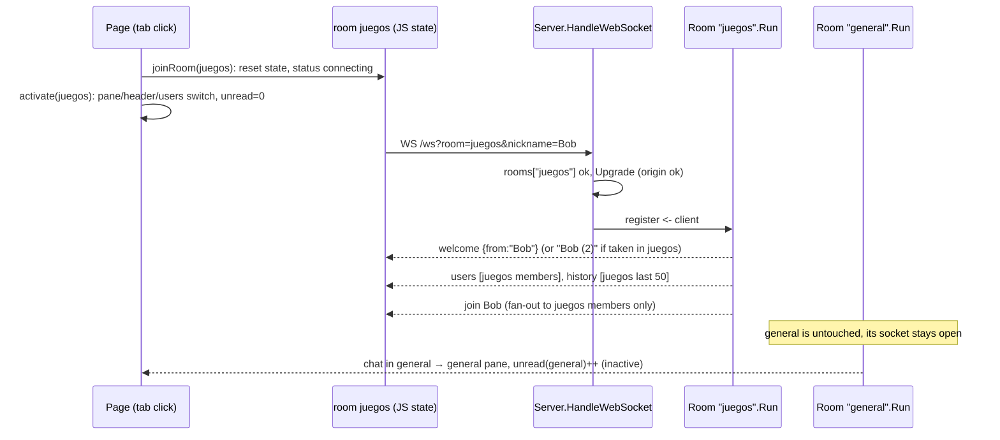
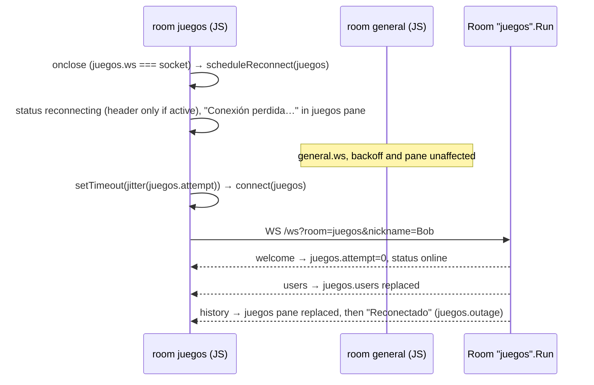

# Design: Multiple rooms

## Technical Approach

A room is still one `chat.Room` value with its own `Run` goroutine. Its registry, `taken`
set, `history` and `dropped` list stay `Run`-owned fields, so "per-room state" just means
"one `Room` per room". None of the hub methods change: `admit`, `leave`, `relay`,
`publish`, `fanOut`, `deliver`, `remove`, `remember`, `userNames` and `assignNickname` are
untouched.

The HTTP side moves off `Room`. A new immutable `chat.Server` (`internal/chat/server.go`)
owns `map[id]*Room`, the default room, the allowed-origin set and the single
`websocket.Upgrader`. Its `HandleWebSocket` resolves the `room` query param first. An
unknown id gets a 404 and no Upgrade. A missing or empty param uses the default room. Then
it upgrades the connection, which runs the origin check (403), and passes the connection to
`room.serveConn`. `serveConn` is the old tail of `Room.HandleWebSocket` (register → wait
`registered` → start the pumps), moved verbatim. `Server.Run(ctx)` runs every room and
returns once all of them have stopped. `main.run` waits on that before `srv.Shutdown`,
which is SRV-03 extended to N rooms.

`cmd/chatroom/main.go` declares `roomIDs`, the single source of the fixed set. It builds
the `chat.Server` from it through one helper, which `run` and `newTestServer` share. It
also serves `GET /rooms` from that same slice. The wire frames do not change.

The page loads `/rooms` at startup and builds one tab (in a `role=tablist` strip under the
header) and one `<ol>` pane per room. Each room gets a state object holding its own socket,
backoff, assigned nickname, users `Set`, `lastAuthor`, outage flag and unread count. Each
socket's handlers close over their room, so frames are routed to the right room without
any lookup. The header (room name, status pill, users count/popover, "vos" tag) always
reflects the active room.

## Architecture Decisions

### Decision: New `chat.Server` owns room lookup, upgrader and origin policy

**Choice**: New file `internal/chat/server.go`:

```go
// Server routes WebSocket connections to a fixed set of rooms. It is never
// modified after NewServer, so concurrent handlers read it without locks.
type Server struct {
    rooms          map[string]*Room
    defaultRoom    *Room // first room passed to NewServer; used when ?room is missing or empty
    allowedOrigins map[string]struct{}
    upgrader       websocket.Upgrader
}

// NewServer panics if rooms is empty or an id is empty or repeated
// (programmer error, like http.ServeMux on a duplicate pattern).
func NewServer(allowedOrigins []string, rooms ...*Room) *Server

// Run runs every room until ctx is cancelled and returns once all have stopped.
// Call it once.
func (s *Server) Run(ctx context.Context) // sync.WaitGroup + wg.Go(func() { r.Run(ctx) }) per room

func (s *Server) HandleWebSocket(c *gin.Context)
func (s *Server) checkOrigin(r *http.Request) bool // moved verbatim from Room
```

What moves and what changes in `room.go`:

| Item | Before | After |
|------|--------|-------|
| `Room.allowedOrigins`, `Room.upgrader` fields | on `Room` | on `Server` (removed from `Room`) |
| `Room.id string` | — | new, immutable, set by `NewRoom` |
| `NewRoom(allowedOrigins []string)` | | `NewRoom(id string)`: the body is unchanged minus the origin/upgrader setup |
| `(*Room).checkOrigin` | `room.go` | `(*Server).checkOrigin` in `server.go`, same body |
| `(*Room).HandleWebSocket(c)` | Upgrade + normalize + register + pumps | removed. Its tail becomes `(*Room).serveConn(conn *websocket.Conn, nickname string)` (register / `done` select, `<-registered`, start pumps) |
| `Run`, channels, all hub methods | | unchanged |

`room.go` stops importing `gin`, `net/http`, `net/url` and `log`. `server.go` imports them.

**Alternatives considered**: (a) Keep the upgrader on `Room` and have a thin router call
`room.HandleWebSocket` after validating the id. That means zero test churn, but it keeps N
copies of one server-wide policy and leaves HTTP concerns inside the hub type (the proposal
asks for one shared policy). (b) `NewServer(ids []string, origins)` building the rooms
itself. Tests that shorten `pongWait`/`writeWait` before starting would then have to dig
`s.rooms[id]` out instead of passing a prepared `*Room`.
**Rationale**: `Room` becomes purely the hub, and `Server` is the only HTTP-facing type.
Taking prepared `*Room` values keeps the existing test pattern (`room := NewRoom(..);
room.pongWait = ..; startServer(t, room)`). `Run` and the channel API stay identical, so
the ~40 white-box tests only change the `NewRoom` argument. `NewRoom` does have to change:
its only parameter was the origin list, which no longer belongs to `Room`. The variadic
order `NewServer(origins, rooms...)` reads well both in `main` and in tests
(`NewServer(nil, room)`).

### Decision: `Room` gets an `id` used for registration and logs only

**Choice**: `id string` field, set in `NewRoom(id)`, never written again. `NewServer`
keys the map by `room.id`. `Client.logError` gains the room id, so the pumps log
`"%s error (room %q, %q): %v"` (signature `c.logError(cr.id, op, err)`). The id is never
sent on the wire.
**Alternatives considered**: Keeping the id only as the map key in `Server`. Then
`NewServer` would need parallel `ids`/`rooms` slices that could get out of sync, and logs
from three identical rooms could not be told apart.
**Rationale**: The value is immutable, so it is safe to read from any goroutine. It makes
`NewServer(origins, rooms...)` self-describing and gives operators the room in error logs.

### Decision: `/ws` handler order: room lookup → 404, then Upgrade (origin → 403)

**Choice**:

```go
func (s *Server) HandleWebSocket(c *gin.Context) {
    room := s.defaultRoom
    if id := c.Query("room"); id != "" {
        r, ok := s.rooms[id] // exact, case-sensitive match against the fixed set
        if !ok {
            c.AbortWithStatus(http.StatusNotFound) // no body: never reflect the id
            return
        }
        room = r
    }
    conn, err := s.upgrader.Upgrade(c.Writer, c.Request, nil) // CheckOrigin: s.checkOrigin
    if err != nil { log.Println("Upgrade error:", err); return }
    room.serveConn(conn, normalizeNickname(c.Query("nickname")))
}
```

- `?room=` (present but empty) is treated as missing, the same way `?nickname=` falls back
  today. `General`, ` general` and `general/x` all get a 404.
- An unknown id is not logged. It is attacker-controlled and only noise.
- A cross-origin request for an unknown room gets 404, not 403. This leaks nothing,
  because `/rooms` already lists the ids publicly.

**Alternatives considered**: Upgrading first and then sending a close frame for an unknown
room. That allocates a connection and goroutines for garbage input, and the client sees a
"connection lost" loop instead of a clear failure. Returning 400 for an unknown room was
also rejected: 404 is what the proposal specifies, and the room is a missing resource.
**Rationale**: The id is validated against the allowlist before any state or socket exists
(secure by default). Old pages and the existing tests that dial bare `/ws` keep working
through the default room.

### Decision: `GET /rooms` and the room list live in `main.go`

**Choice**:

```go
// roomIDs is the fixed room set, in display order; the first is the default room.
var roomIDs = []string{"general", "juegos", "musica"}

// newChatServer builds one Room per roomIDs entry behind a shared origin policy.
func newChatServer(allowedOrigins []string) *chat.Server

// serveRooms returns the room list as {"rooms":[...]}.
func serveRooms(c *gin.Context) {
    setStaticHeaders(c) // nosniff + Cache-Control: no-cache
    c.JSON(http.StatusOK, struct {
        Rooms []string `json:"rooms"`
    }{roomIDs})
}

func newRouter(chatSrv *chat.Server) *gin.Engine // + r.GET("/rooms", serveRooms); /ws → chatSrv.HandleWebSocket
```

The response is `200`, `Content-Type: application/json; charset=utf-8`,
`X-Content-Type-Options: nosniff`, `Cache-Control: no-cache`, and the body is exactly
`{"rooms":["general","juegos","musica"]}`. `newChatServer` and `serveRooms` both read
`roomIDs`, so the list and the `/ws` allowlist cannot diverge.
**Alternatives considered**: (a) `(*chat.Server).HandleRooms`. The `chat` package would
then need its own copy of the static-header logic, which lives in `main`. (b) A JS
constant mirrored by a string test, like `IMAGE_HOSTS`. That is a third hand-kept copy,
and the proposal rejected it.
**Rationale**: HTTP response policy (headers, routes) already lives in `main.go`. A
package-level slice next to `imageHosts` follows the existing pattern for fixed
configuration. `c.JSON` escapes properly and adds no dependency.

### Decision: Shutdown waits for every room through `Server.Run`

**Choice**: `run()` becomes:

```go
chatSrv := newChatServer(parseAllowedOrigins(allowedOrigins))
roomsDone := make(chan struct{})
go func() { chatSrv.Run(ctx); close(roomsDone) }()
...
cancel()
<-roomsDone // every room closed its clients; Shutdown does not close hijacked conns
srv.Shutdown(shCtx)
```

`Server.Run` uses one `sync.WaitGroup` (`wg.Go`, Go 1.27). Each room still closes its own
`done`, so `serveConn`/pump selects on `cr.done` behave exactly as before.
**Alternatives considered**: Looping over the rooms in `main` with N done channels. That
duplicates the wait logic between `main` and the tests and exposes the room slice to
`main`.
**Rationale**: "Wait for all rooms" lives in one function that main and the tests share.
The WaitGroup only synchronizes goroutine exit, and the rooms share no mutable state.

### Decision: Tab strip under the header, not a sidebar

**Choice**: A horizontal strip between `.chat-header` and `.rule`:

```html
<nav class="rooms" aria-label="Salas">
  <div id="room-tabs" class="room-tabs" role="tablist" aria-label="Salas"></div>
  <button id="room-leave-btn" type="button" class="btn btn-ghost room-leave" disabled>Dejar sala</button>
</nav>
```

JS builds one tab per room with `createElement` and `textContent`:

```html
<button type="button" role="tab" id="tab-juegos" class="room-tab" aria-selected="false"
        aria-controls="scroller" aria-label="#juegos, sin unirte">
  <span class="room-tab-name">#juegos</span><span class="room-unread" hidden>3</span>
</button>
```

- State classes and attributes: `.joined` on joined rooms (unjoined tabs are muted).
  `aria-selected="true"` marks the active room, following the `.cats` precedent and
  styling. The `.room-unread` pill is visible only when the unread count is above 0 and
  shows `99+` above 99.
- `aria-label` is rebuilt on every state change: `#id`, plus `, sin unirte` when the room
  is not joined, plus `, N sin leer` when there are unread messages. A bare number badge
  would mean nothing to a screen reader.
- `#scroller` gets `role="tabpanel"` and `aria-labelledby` set to the active tab's id.
  Every tab has `aria-controls="scroller"`.
- Keyboard: tabs are plain focusable buttons (Tab/Enter/Space), as in the existing `#cats`
  tablist. Roving tabindex and arrow keys are not added, to match the precedent.
- Mobile (≤560px): `.room-tabs` keeps one row with `overflow-x: auto`, and
  `#room-leave-btn` stays pinned at the end (`flex: none`). Nothing in the header is added
  or reflowed.
- CSS uses only existing tokens: `.rooms { display:flex; align-items:center; gap:var(--space-4); padding:0 var(--gutter) var(--space-3); flex:none }`,
  `.room-tabs { display:flex; gap:var(--space-2); overflow-x:auto; min-width:0 }`,
  `.room-tab { … }` / `.room-tab:not(.joined) { color: muted }` /
  `.room-tab[aria-selected="true"] { background:var(--color-accent-900); box-shadow:0 0 0 1px var(--color-accent-700) }`,
  `.room-unread { font-size:11px; border-radius:var(--radius-sm); background:var(--color-accent); … }`.

**Alternatives considered**: A sidebar. It needs a new two-column layout plus a collapse
behavior at 560px, which is a lot of CSS for 3 rooms, and the last change already rejected
a sidebar for the same reason. A `<select>` was also considered: it cannot show unread
counts or joined state per option.
**Rationale**: The strip reuses the existing `role=tablist` pattern, adds one flex row,
works the same on mobile through horizontal scrolling, and keeps the header width
unchanged (it was already tight at 560px).

### Decision: Per-room client state; handlers close over their room

**Choice**: In `app.js`, the globals `ws`, `myName`, `status`, `lastAuthor`, `retryTimer`,
`attempt`, `outage` and `users` move into a per-room object:

```js
// One per configured room, in /rooms order. Only `active` drives the header.
const rooms = new Map(); // id -> room
let active = null;       // the room whose pane and header are shown
let requestedNick = '';  // shared; re-sent by every room's socket

function createRoom(id) // returns { id, tab, unreadEl, list,
                        //   joined: false, ws: null, retryTimer: null, attempt: 0, outage: false,
                        //   status: 'connecting', myName: '', users: new Set(), lastAuthor: null, unread: 0 }
```

`createRoom` also appends the tab to `#room-tabs` and a pane
`<ol id="pane-<id>" class="messages" aria-live="polite" hidden>` to `#scroller`. The
static `<ol id="messages">` is removed from `index.html`. Hidden live regions are not
announced, so only the active room speaks.

Functions take the room explicitly:

| Function | Change |
|----------|--------|
| `connect(room)` | URL `'/ws?room=' + encodeURIComponent(room.id) + '&nickname=' + …`. Handlers: `if (room.ws !== socket) return; addRaw(room, e.data)` and `if (room.ws !== socket) return; scheduleReconnect(room)` |
| `scheduleReconnect(room)` / `reconnectNow(room)` | Same backoff logic on `room.attempt`, `room.retryTimer` and `room.outage`. The `online`/`visibilitychange` listeners call `reconnectNow` for every joined room |
| `setStatus(room, s)` | Sets `room.status`. If `room === active`, it updates `#status`/`#status-label` and calls `updateSendState()` |
| `addRaw(room, data)` | Same parsing and guards. `welcome` → `room.myName`, `room.attempt = 0`, `setStatus(room,'online')`, and if active, `#me`. `users`/`join`/`leave` patch `room.users` and call `renderUsers()` only if active. `chat` → `addChat(room, …)` and, when `room !== active && msg.from !== room.myName`, `bumpUnread(room)` |
| `renderHistory(room, msgs)` | On `room.list` and `room.lastAuthor`. "Reconectado" goes in `room.list` if `room.outage`. History does not count as unread |
| `addSystem(room, text)`, `addChat(room, …)`, `append(room, node)` | Write to `room.list`. `append` scrolls only if `room === active`. `own` is `author === room.myName` |
| `renderUsers()` | Renders `active.users` and `active.myName` |
| `updateSendState()` / `sendText(text)` | Use `active.status` / `active.ws`. "El mensaje es demasiado largo." goes to `active` |

**Alternatives considered**: Keeping the globals and swapping them on room switch. Frames
for inactive rooms would then write to the wrong state. A single `onmessage` that looks up
the room by socket in a `Map` is an extra lookup that a closure already provides.
**Rationale**: The closure gives each frame its owning room by construction, and the
existing `ws !== socket` stale-socket guard carries over unchanged as `room.ws !== socket`.
Reconnects stay independent, with a separate jittered backoff per socket.

### Decision: Join, switch, leave and "Salir" flows

**Choice**:

- **Startup**: `const roomsReady = loadRooms()`. It fetches `/rooms`, requires
  `Array.isArray(body.rooms)`, keeps only strings matching `/^[a-z0-9-]{1,32}$/` (safe in
  element ids and URLs), requires at least one, and calls `createRoom` for each.
- **Nickname submit**: `await roomsReady`. If it rejected, retry `loadRooms()` once. If
  that fails too, show `#join-error` ("No pudimos cargar las salas. Probá de nuevo."),
  keep the join view and stop. Otherwise `requestedNick = nick`, show `#chat-view`,
  `joinRoom(firstRoom)`, `activate(firstRoom)`, and focus `#draft`.
- **`joinRoom(room)`**: `room.joined = true`, reset its state (`list.replaceChildren()`,
  `users = new Set()`, `myName = ''`, `lastAuthor = null`, `attempt = 0`,
  `outage = false`, `unread = 0`), `setStatus(room, 'connecting')`, `connect(room)`,
  `renderTab(room)`.
- **Tab click**: `if (!room.joined) joinRoom(room); activate(room);`. Clicking the active
  tab does nothing.
- **`activate(room)`**: set `active`, `aria-selected` on all tabs, `hidden` on all panes
  except `room.list`, `#scroller[aria-labelledby]`, `#room-name` = `'#' + id`,
  `#me` = `room.myName || requestedNick`, the status pill from `room.status`,
  `renderUsers()`, `unread = 0`, `renderTab`, `scrollToBottom()`, `updateSendState()`,
  and `updateLeaveBtn()`. Focus is not moved, so keyboard users stay on the tab and the
  draft text is kept.
- **"Dejar sala"** (`#room-leave-btn`) leaves the **active** room:
  `teardown(room)`, which clears its timer, sets `ws = null` and then closes the socket so
  its `onclose` does nothing, sets `joined = false`, clears the pane, users and unread,
  and calls `renderTab`. Then it activates the first joined room in list order. The button
  is disabled while only one room is joined: leaving the last room is what "Salir" does.
  The server sends `leave` only in that room, because only that socket closed.
- **"Salir"**: `teardown` every joined room, `closePanels()`, clear the draft, show the
  join view, focus `#nick`. Same as today, applied to N rooms.

**Alternatives considered**: A × button inside each tab, which would allow leaving
inactive rooms. That puts an interactive element inside `role=tab`, which is invalid ARIA.
Letting the user leave the last room into an empty "no room" state was also rejected: it
is an extra UI state with no purpose. Falling back to the bare `/ws` room when `/rooms`
fails was rejected too: the page and `/rooms` come from the same binary, so a failure
means the server is unreachable, and the socket would fail as well.
**Rationale**: The flows cover every proposal requirement with one new button. To leave an
inactive room, the user activates it and then clicks "Dejar sala", which takes one extra
click with 3 rooms. Each socket's `welcome` drives "vos" per room, so `Bob (2)` in one room
is marked correctly.

### Decision: Unread counts only live chat in inactive rooms

**Choice**: `bumpUnread(room)` increments `room.unread` and calls `renderTab(room)`. It
runs only for `chat` frames that are live (not from `history`), arrive in a room other
than `active`, and come from someone other than that room's `myName`. `activate` resets
the count to 0. Join/leave notices and system lines never count.
**Alternatives considered**: Counting every frame, which makes the badge noisy because
reconnects would count. Tracking a "last read" timestamp, which is more state for no
benefit when there is no persistence.
**Rationale**: This matches what users expect from "N sin leer". History replay is a
re-sync, not new activity.

## Data Flow

### `/ws` request

```
GET /ws?room=R&nickname=N
  Server.HandleWebSocket
    R == ""            → room = defaultRoom (general)
    rooms[R] missing   → 404, no Upgrade, nothing allocated
    upgrader.Upgrade   → checkOrigin fails → 403 (SRV-01, every room)
    room.serveConn(conn, normalizeNickname(N))
      register <- client | <-done → close     (unchanged)
      <-client.registered; go writePump(room); go readPump(room)
```

### Joining a second room (user already in `general`, clicks `#juegos`)



### Reconnect of one room (juegos socket drops, general stays up)



`online`/`visibilitychange` call `reconnectNow(room)` for every joined room. Each one acts
only if that room is waiting or stuck connecting.

### Shutdown with N rooms

```mermaid
sequenceDiagram
    participant M as main.run
    participant SR as Server.Run (WaitGroup)
    participant R1 as Room general.Run
    participant R2 as Room juegos.Run
    participant R3 as Room musica.Run
    participant H as http.Server
    M->>M: ctx cancelled (signal) or Serve error → cancel()
    par each room
        SR->>R1: ctx.Done → remove all (close send) → close(done)
        SR->>R2: ctx.Done → remove all → close(done)
        SR->>R3: ctx.Done → remove all → close(done)
    end
    Note over R1,R3: writePumps send close frames; serveConn/readPump unblock on done
    SR-->>M: wg.Wait returns → close(roomsDone)
    M->>H: Shutdown(5s) — listeners and idle HTTP conns
```

### Client frame routing

```
room.ws.onmessage ─ (room.ws === socket?) ─ addRaw(room, data)
  welcome → room.myName, status(room)            [header if active]
  users   → room.users = Set                     [renderUsers if active]
  history → room.list replaced, [Reconectado]
  join/leave → room.users ± , notice in room.list [renderUsers if active]
  chat    → addChat(room) ; inactive && not own → unread++ → tab badge
```

## Testing

### Helper changes

`internal/chat/client_test.go`:
- New `startRooms(t, allowed []string, rooms ...*Room) (*httptest.Server, context.CancelFunc)`.
  It builds `NewServer(allowed, rooms...)`, routes `/ws` to `HandleWebSocket`, runs
  `go s.Run(ctx)`, and cleans up with cancel + `srv.Close()`.
- `startServer(t, room)` keeps its signature and becomes `startRooms(t, nil, room)`, so
  most e2e tests are untouched apart from the `NewRoom` argument.
- New `dialRoomRaw(t, srv, room, nick)` / `dialRoom(t, srv, room, nick) (*websocket.Conn, string)`
  add `&room=` (room is query-escaped). `dialOrigin`/`dialRaw`/`dial` keep dialing bare
  `/ws` (default room).
- `TestWebSocketOriginCheck` uses `startRooms(t, tt.allowed, NewRoom("general"))`.
- `TestDroppedSlowClientConnectionIsClosed`: `s := NewServer(nil, room)`, routes `/ws` to
  `s.HandleWebSocket`, and `/slow` uses `s.upgrader.Upgrade`.
- Every `NewRoom(nil)` becomes `NewRoom("general")`.

`internal/chat/room_test.go`:
- Every `NewRoom(nil)`/`NewRoom(tt.…)` becomes `NewRoom("general")` (in `startRoom`,
  `TestSaturationNoDeadlock`, `TestChatBeforeLeaveOnDisconnect`,
  `TestLeaveAfterDrainDroppedClient`, `TestSlowDropCascadeAnnounced`, `TestAssignNickname`,
  `TestNewRoomDefaults`).
- `TestNewRoomDefaults` also asserts `cr.id == "general"`.
- `TestCheckOrigin` moves to `server_test.go` and builds
  `NewServer(tt.allowed, NewRoom("general")).checkOrigin(r)`. Its cases do not change.

`cmd/chatroom/main_test.go`:
- `newTestServer` uses `newChatServer(nil)`, `go chatSrv.Run(ctx)` and
  `newRouter(chatSrv)`.
- `TestRunGracefulShutdown`, `TestWebSocketSameOriginNoAllowlist`, the CSP/no-inline tests
  and `TestIndexHasOnlineList` are unchanged. They dial bare `/ws`, which now goes to the
  default room.

### New tests

| Test | File | Asserts |
|------|------|---------|
| `TestNewServerPanics` | server_test | panics for no rooms, an empty id, and a duplicate id |
| `TestUnknownRoomIs404` | server_test | `?room=nope`, `?room=General`, `?room=general%20` → dial fails with `resp.StatusCode == 404` (no 101). Afterwards a client in `general` gets `users` == only itself (nothing was registered) |
| `TestDefaultRoom` | server_test | rooms `general`,`juegos`: A dials bare `/ws`, B dials `?room=` (empty), C dials `?room=general` → C's users == [A B C] |
| `TestRoomsIsolated` | server_test | A in general sends "hola". B in juegos sends "x" and its next frame is `chat B x` (no hola). C joining juegos gets users [B C] and history [x]. D joining general gets history [hola] |
| `TestNicknameUniquePerRoom` | server_test | `Bob` in general and `Bob` in juegos are both welcomed as `Bob`. A second `Bob` in juegos gets `Bob (2)` |
| `TestLeaveOneRoomKeepsOther` | server_test | A and O are each in both rooms. A closes its general conn → O(general) gets `leave A`. O(juegos) next frame after a sync chat is that chat (no leave). A(juegos) can still send and receive |
| `TestOriginCheckAppliesToEveryRoom` | server_test | foreign Origin on `?room=juegos` → 403 |
| `TestServerRunWaitsForAllRooms` | server_test | `NewServer(nil, r1, r2)`. After cancel, `Run` returns only after `r1.done` and `r2.done` are closed. Clients dialed into both rooms get a read error |
| `TestRoomsEndpoint` | main_test | `GET /rooms` → 200, `Content-Type: application/json; charset=utf-8`, nosniff, `Cache-Control: no-cache`, body exactly `{"rooms":["general","juegos","musica"]}` |
| `TestWebSocketRoomParam` | main_test | via `newTestServer`: `?room=juegos` → welcome; `?room=nope` → 404 |
| `TestRunShutdownClosesAllRooms` | main_test | `run()` with clients in `general` and `musica`; cancel → both conns get a read error (not a timeout), and `run` returns 0 |
| `TestIndexHasRoomTabs` | main_test | `index.html` contains `id="room-tabs"`, `role="tablist"` (on room-tabs), `id="room-leave-btn"`, `id="room-name"`, `id="join-error"`, `role="tabpanel"`, and no longer contains `id="messages"` |

Client behavior that has no JS harness goes in the manual verify checklist: tab
states/unread/`99+`, switching keeps the draft, "Dejar sala" is disabled with one room,
"Salir" closes every socket (server logs/leave in each room), killing one room's socket
reconnects only that room with "Reconectado" in its pane, a `/rooms` failure shows
`#join-error`, the 560px strip scrolls, and the screen reader reads the tab
`aria-label`s. `go vet ./...` and `go test -race ./...` must pass.

## File Changes

| File | Action | Description |
|------|--------|-------------|
| `internal/chat/server.go` | Create | `Server` (rooms map, default room, origins, upgrader), `NewServer(origins, rooms...)`, `Run` (WaitGroup over rooms), `HandleWebSocket` (lookup → 404 / default → Upgrade → `serveConn`), `checkOrigin` (moved) |
| `internal/chat/room.go` | Modify | Add `id`. `NewRoom(id string)`. Remove `allowedOrigins`/`upgrader`/`checkOrigin`/`HandleWebSocket`. Add `serveConn(conn, nickname)` (the old handler tail). Drop the gin/http/url/log imports |
| `internal/chat/client.go` | Modify | `logError(roomID, op, err)` includes the room id. The pumps pass `cr.id` |
| `internal/chat/server_test.go` | Create | New server tests above and the moved `TestCheckOrigin` |
| `internal/chat/client_test.go` | Modify | `startRooms`, `startServer` wrapper, `dialRoom`/`dialRoomRaw`, `NewRoom("general")`, origin and slow-client tests adapted |
| `internal/chat/room_test.go` | Modify | `NewRoom("general")`, `TestCheckOrigin` removed (moved), `TestNewRoomDefaults` asserts id |
| `cmd/chatroom/main.go` | Modify | `roomIDs`, `newChatServer`, `serveRooms`, `newRouter(*chat.Server)` with `/rooms`, `run` waits on `chatSrv.Run` before `Shutdown` |
| `cmd/chatroom/main_test.go` | Modify | `newTestServer` uses `newChatServer`. New `/rooms`, room param, all-rooms shutdown and markup tests |
| `cmd/chatroom/index.html` | Modify | `nav.rooms` with `#room-tabs[role=tablist]` + `#room-leave-btn`. `.subtitle` becomes `#room-name`. `#scroller[role=tabpanel]` with no static `<ol id="messages">`. `#join-error` (role=alert, hidden) in the join form |
| `cmd/chatroom/app.js` | Modify | `loadRooms`, `createRoom`, per-room state object, `joinRoom`/`activate`/`teardown`, room-aware `connect`/reconnect/`addRaw`/render functions, unread, "Dejar sala", "Salir" for all rooms |
| `cmd/chatroom/app.css` | Modify | `.rooms`, `.room-tabs`, `.room-tab` (+ `.joined`, `[aria-selected="true"]`), `.room-unread`, `.room-leave`, `.join-error`. Mobile: horizontal scroll |
| `README.md` | Modify | `GET /rooms`, the `room` query param (default/404), per-room users/history/nicknames |

## Open Risks

- **No JS tests** for routing, unread and per-room reconnect. This is mitigated by the
  closure-per-socket design (no lookup to get wrong), Go string assertions on the markup,
  and the manual checklist.
- **The inactive room's connection state is invisible** apart from the notices in its
  pane, because the header shows only the active room. This is accepted for 3 rooms, since
  outages normally hit every socket at once.
- **Draft follows the active room**: text typed in one room and sent after switching goes
  to the new room. This is the same as any tabbed chat. Accepted.
- **Tablist without arrow-key navigation**: this matches the `#cats` precedent, but it
  does not fully follow the WAI-ARIA tabs pattern. It is a candidate for a later a11y pass.
- **`NewRoom` signature change**: about 25 test call sites change mechanically (`nil` →
  `"general"`). `Run` and the channel API are unchanged.
- **Up to 3× sockets and history replays per user** after an outage, each with its own
  jitter. This is bounded by the fixed set.
