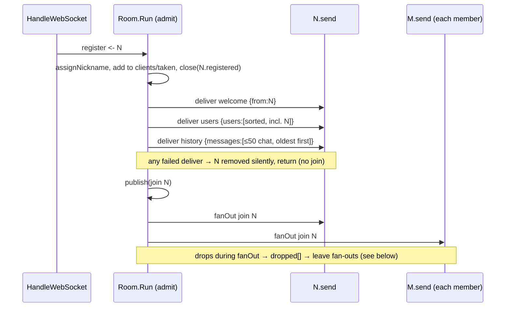

# Design: Online users list and message history

## Technical Approach

Everything new on the server is state owned by `Room.Run`, so there are still no locks:

- a `history []message` window of the last 50 `chat` messages, appended in `relay`;
- a `dropped []*Client` list of clients that a fan-out removed for being slow and that
  have not been announced yet.

The register case becomes `admit(c)`. It sends three private frames (`welcome` → `users`
→ `history`) and then fans out the `join`. All fan-outs of room events go through a new
`publish(msg)`. It calls `fanOut` and then announces a `leave` for every client that
fan-out dropped. It keeps going until no drops are pending, which handles cascades.
Shutdown still calls `remove` directly, so it stays silent.

`message.go` gets two new frame structs with their own JSON shape. History entries are
plain `message` values, so each entry is a standard 4-field chat envelope.

On the page, `addRaw` handles `users` and `history` before checking `from`. A `Set` of
names drives a "N en línea" header button and a popover that reuses `.popover` and
`closePanels`. `history` replaces `#messages`. The "Reconectado" notice moves from the
`welcome` branch to just after the history is rendered, so the replacement does not
wipe it.

## Architecture Decisions

### Decision: Frame structs and a generic `encode`

**Choice**: In `message.go`:

```go
const (
    typeUsers   = "users"
    typeHistory = "history"
    historySize = 50 // chat messages kept for newcomers
)

// usersFrame is the private snapshot of connected nicknames sent on join.
type usersFrame struct {
    Type  string   `json:"type"`  // always "users"
    Users []string `json:"users"` // never nil: [] when empty (unreachable: includes the newcomer)
    TS    int64    `json:"ts"`
}

// historyFrame is the private replay of recent chat messages sent on join.
type historyFrame struct {
    Type     string    `json:"type"`     // always "history"
    Messages []message `json:"messages"` // oldest first, never nil: [] when empty
    TS       int64     `json:"ts"`
}

func encode(v any) []byte // was encode(m message); body unchanged
```

JSON key order is the struct order: `type` first, `ts` last, and no `omitempty`. The
`message` struct and its doc comment ("every frame carries all four fields") stay as they
are. The comment is reworded to say this applies to `chat`/`join`/`leave`/`welcome`.

**Alternatives considered**: (a) `encodeUsers`/`encodeHistory` helpers, one per type. This
means three copies of the same marshal-and-log body. (b) Storing history as encoded
`[]byte` and embedding it with `json.RawMessage`. That gives byte-identical replay, but
the code is less clear and tests have to decode it twice. Re-encoding 50 small structs per
join costs nothing.
**Rationale**: `json.Marshal` already takes `any`. Changing the parameter type is a
one-line change, existing call sites compile unchanged, and every encode error goes
through the same nil-on-error rule.

### Decision: Users snapshot sorted by `foldKey`

**Choice**: `cr.userNames()` collects `c.nickname` for every member into
`make([]string, 0, len(cr.clients))` (never nil). It sorts with
`slices.SortFunc(names, func(a, b string) int { return strings.Compare(foldKey(a), foldKey(b)) })`.
`taken` guarantees that `foldKey` is unique among members, so there are no ties and the
order is total and deterministic. A stable sort is not needed.
**Alternatives considered**: Byte order (`sort.Strings`), which puts every `Bob` before
every `alice`. Locale collation, which needs `golang.org/x/text` (a new dependency).
**Rationale**: This reuses the folding the room already uses for uniqueness, and tests
can predict the order. It is case-insensitive but code-point based, so `Ángel` sorts
after `Zoe`. The page re-sorts for display anyway (see the client decision), so the
server order only has to be deterministic.

### Decision: History as a capped slice with copy-on-evict

**Choice**: `NewRoom` sets `history: make([]message, 0, historySize)`. `relay` builds the
`message` once, encodes it, and on success calls `cr.remember(m)` before `publish`:

```go
// remember appends m to the history window, evicting the oldest past historySize. Run-only.
func (cr *Room) remember(m message) {
    if len(cr.history) == historySize {
        copy(cr.history, cr.history[1:])
        cr.history = cr.history[:historySize-1]
    }
    cr.history = append(cr.history, m)
}
```

`relay` is the only writer, so join, leave and welcome frames are never stored. A message
from a non-member is discarded before encoding, so it is never stored either. The history
frame is marshaled inside `Run` from `cr.history` directly. No copy is needed because
nothing aliases it after `json.Marshal` returns.
**Alternatives considered**: A circular buffer with a head index (needs modular index
math and reordering when building the snapshot). `append(h[1:], m)` (looks simpler, but
the backing array keeps sliding and reallocating, which is a quieter cost).
**Rationale**: Each eviction moves 49 small structs. That is trivial, the backing array
never reallocates, and the code is obvious to read.

### Decision: Join sequence in `admit`, stop at the first failed private delivery

**Choice**: The register case calls `cr.admit(c)`:

```go
func (cr *Room) admit(c *Client) {
    name := cr.assignNickname(c.nickname)
    c.nickname = name
    cr.clients[c] = struct{}{}
    cr.taken[foldKey(name)] = struct{}{}
    close(c.registered)
    ts := time.Now().UnixMilli() // one ts for welcome, users, history and join
    private := [][]byte{
        encode(message{typeWelcome, name, "", ts}),
        encode(usersFrame{typeUsers, cr.userNames(), ts}),
        encode(historyFrame{typeHistory, cr.history, ts}),
    }
    for _, f := range private {
        if f == nil || !cr.deliver(c, f) {
            return // newcomer never announced: no join, and a drop here stays silent
        }
    }
    if join := encode(message{typeJoin, name, "", ts}); join != nil {
        cr.publish(join)
    }
}
```

`users` includes the newcomer, because it is already in `clients`. Private frames use
`deliver` directly, not `fanOut`, so a newcomer dropped here is never added to `dropped`.
Nobody saw its join, so nobody needs its leave.
**Alternatives considered**: Sending the join before users/history, which makes the
newcomer's own join show up before the list it belongs to. Skipping the empty frames
(the client would then need conditional logic).
**Rationale**: This is the same "only announce what was delivered" rule as today's
welcome→join gate, extended to three frames. It keeps the invariant: **a client gets a
leave only if its join was fanned out.**

### Decision: Announce slow drops with `publish` (fan out, then drain `dropped`)

**Choice**:

```go
// fanOut delivers msg to every member; slow ones are removed and queued in dropped.
func (cr *Room) fanOut(msg []byte) {
    for c := range cr.clients {
        if !cr.deliver(c, msg) {
            cr.dropped = append(cr.dropped, c)
        }
    }
}

// publish fans msg out and then announces a leave for every client dropped as slow,
// including clients dropped by those announcements. Run-only.
func (cr *Room) publish(msg []byte) {
    cr.fanOut(msg)
    for i := 0; i < len(cr.dropped); i++ { // fanOut below may append
        c := cr.dropped[i]
        if leave := encode(message{typeLeave, c.nickname, "", time.Now().UnixMilli()}); leave != nil {
            cr.fanOut(leave)
        }
    }
    clear(cr.dropped)
    cr.dropped = cr.dropped[:0]
}
```

- `deliver` is unchanged: it removes the client, closes `send` and returns false. It stays
  silent by itself. Only `fanOut` records drops.
- `relay`, `leave` and `admit` (for the join) call `publish`. Nothing else calls `fanOut`
  directly.
- **No double announcement**: a client is added to `dropped` only while it is a member,
  and `deliver` removes it at that moment, so it can be added at most once. `dropped` is
  empty when every `publish` returns, so it is empty between `Run` cases.
- **The cascade ends**: every iteration either drops a member or does nothing, and the
  number of members is finite.
- **`leave(c)`**: `drainBroadcast` → `relay` → `publish` can drop *and announce* `c`.
  The existing second membership check then returns. The comment changes from "silent,
  CHAT-02" to "already announced by the drain's publish". Otherwise `remove(c)` +
  `publish(leave)`. If `c` was slow-dropped earlier, it was announced back then, and the
  first membership check makes a later `unregister` a no-op.
- **Shutdown** (`ctx.Done`) calls `remove` directly with no `publish`, so it stays silent.
- Reading `c.nickname` after `remove` is safe. Only `Run` writes it, and only before
  `close(registered)`.

**Alternatives considered**: (a) Announcing inside `deliver`. This sends from inside the
fan-out loop, which recurses and interleaves a leave in the middle of another fan-out.
(b) Draining `dropped` once per iteration of the `Run` loop. That is one call site, but
`leave()`/`relay()` would no longer be self-contained: the tests that call `cr.leave`
directly without `Run` would miss the announcements, and leaves would wait for the
end-of-case boundary. (c) A boolean flag on `fanOut`. This mixes two jobs and hides the
loop.
**Rationale**: One function covers "an event the room broadcasts". Recipients always see
the triggering event first and then the leaves it caused. No locks are needed and `Run`
never sends on its own channels (CHAT-03).

### Decision: Client keeps a `Set` of names, the server snapshot is authoritative

**Choice**: `let users = new Set()`. `users` frame: `users = new Set(names that are
strings)`. `join`: `users.add(from)`. `leave`: `users.delete(from)`. Each change calls
`renderUsers()`. `renderUsers` sorts a copy with
`a.localeCompare(b, 'es', { sensitivity: 'base' })`, rebuilds `#users-list` with
`createElement` + `textContent`, and sets `#users-count` to `users.size`. The own name
(`=== myName`) gets the existing `tag tag-accent` "vos" span, the same marker used on own
messages. `join()` clears the set and re-renders. The set is not cleared during an
outage: the status pill already says "Reconectando…", and the next `users` frame
replaces the set.
**Alternatives considered**: An array (duplicate checks are O(n) and need extra care).
Rendering in server order (wrong order for accented names, and joins would have to be
inserted in order).
**Rationale**: Names are unique while connected, so a `Set` matches the domain exactly.
Re-rendering at most a few dozen `<li>`s is cheap and avoids patching the DOM in place.

### Decision: `history` replaces the transcript; "Reconectado" moves after it

**Choice**:

- `addRaw` handles `users`/`history` (no `from`) first and returns. Then it applies the
  existing `typeof msg.from !== 'string'` guard and the existing switch.
- `welcome`: unchanged, except it **no longer** adds "Reconectado" or clears `outage`.
- `history`: `renderHistory(msg.messages)` when `Array.isArray`:
  1. `const list = $('messages'); list.setAttribute('aria-busy', 'true');`
  2. `list.replaceChildren(); lastAuthor = null;`
  3. for each entry: `if (m && m.type === 'chat' && typeof m.from === 'string' && typeof m.text === 'string') addChat(m.from, m.text, m.ts);`
     History images go through `isAllowedImage` inside `addChat`, the same as live
     messages.
  4. `list.removeAttribute('aria-busy');`
  5. `if (outage) { outage = false; addSystem('Reconectado'); }`
- If the socket dies between `welcome` and `history`, `outage` is still true.
  `scheduleReconnect` therefore adds no second "Conexión perdida", and the next history
  adds "Reconectado" once.
- Side effect, accepted: local notices from before the outage ("Conexión perdida…", "El
  mensaje es demasiado largo.", join/leave lines) are replaced by the server's history.
  This is the CHAT-16 amendment.

**Alternatives considered**: Keeping the DOM and de-duplicating by `(from, ts, text)`.
This is fragile with equal timestamps and still misses messages sent during the outage.
Adding "Reconectado" in `welcome` and re-adding it after the history (two notices, one
of them wiped).
**Rationale**: Replacing the transcript is idempotent and simple. Moving the notice to
after the history keeps it as the last line, which is where the user looks.

### Decision: Online popover in the header, reusing `panels`/`closePanels`

**Choice**: Markup in `.actions`, before `#me`:

```html
<div class="online">
  <button id="users-btn" type="button" class="btn btn-ghost tool tool-users"
          aria-expanded="false" aria-controls="users-panel">
    <span id="users-count">0</span> en línea
  </button>
  <div id="users-panel" class="popover users" hidden>
    <div class="users-title text-muted">En línea</div>
    <ul id="users-list" class="users-list" aria-label="Personas en línea"></ul>
  </div>
</div>
```

`app.js` adds `users: { panel: $('users-panel'), btn: $('users-btn') }` to `panels` plus
a click listener calling `togglePanel('users')`. This gives Escape, outside click
(`.popover, .tool`), mutual exclusion with the emoji/GIF panels and `aria-expanded` for
free. Leaving the chat already calls `closePanels()`.

CSS (class-based only):

```css
.online { position: relative; }
.tool-users { white-space: nowrap; font-size: 12px; padding: 0 10px; height: 32px; }
.popover.users { top: calc(100% + 8px); bottom: auto; left: auto; right: 0; width: min(260px, 85vw); max-height: 50vh; overflow-y: auto; }
.users-title { font-size: 12px; }
.users-list { list-style: none; margin: 0; padding: 0; display: flex; flex-direction: column; gap: var(--space-2); }
.users-list li { display: flex; align-items: center; gap: var(--space-3); font-size: 14px; overflow-wrap: anywhere; }
.users-list .tag { font-size: 10px; padding: 0 6px; }
@media (max-width: 560px) { .chat-header .tag { max-width: 96px; } } /* inside the existing block */
```

The count and list are **not** live regions: join/leave are already announced in
`#messages`.
**Alternatives considered**: A sidebar (a new layout and breakpoint work, rejected in the
proposal). A native `<details>` (it does not close on outside click or Escape like the
other panels do).
**Rationale**: This uses the existing panel mechanics with no new pattern, keeps CSP and
no-inline rules intact, and works the same on mobile.

## Data Flow

### Join (newcomer `N`, members `M…`)



### Slow-drop cascade (`relay` of a chat from `O`; `X` has buffer 0, `Y` has buffer 1)

```
relay(O,"hi") ─ remember(chat) ─ publish(chat)
   fanOut(chat):   O ✓   X ✗ (remove, dropped=[X])   Y ✓ (buffer now full)
   i=0 leave X →   fanOut: O ✓   Y ✗ (remove, dropped=[X,Y])
   i=1 leave Y →   fanOut: O ✓
   clear(dropped)
O receives: chat hi, leave X, leave Y      (each exactly once, after the cause)
```

### Leave whose drain drops the leaving client

```
unregister c ─ leave(c): member? yes ─ drainBroadcast ─ relay ─ publish
                         └─ c dropped during the drain → announced inside that publish
                         member? no → return            (no second leave, no double close)
```

### Client

```
welcome ─ myName, status online
users   ─ users = Set(names) ─ renderUsers()          (count + popover list)
history ─ aria-busy, replaceChildren, lastAuthor=null, addChat×n, unbusy, [Reconectado]
join    ─ users.add + renderUsers + "X se unió"
leave   ─ users.delete + renderUsers + "X salió"
chat    ─ addChat (unchanged)
```

## Testing

### Helper changes

`room_test.go`:
- `decode` is unchanged (it is still the strict 4-field check for chat/join/leave/welcome).
- New `decodeUsers(t, raw) usersFrame` and `decodeHistory(t, raw) historyFrame`. Each
  requires exactly the keys `type`/`users|messages`/`ts` and the right type, and requires
  the array to be `[]` and not `null`. `decodeHistory` also runs every entry (as
  `json.RawMessage`) through `decode` and requires `typeChat`.
- New `nextRaw(t, c) []byte`. `next` becomes `decode(t, nextRaw(t, c))`.
- New `expectWelcome(t, c, name) (users usersFrame, hist historyFrame)` consumes welcome,
  users and history in that order and asserts the shared ts. It replaces every
  `expect(t, x, typeWelcome, name, "")`.
- New `expectUsers`/`expectHistory` assertions (compare names, and type/from/text
  ignoring ts) used by the new tests.
- `syncRoom` uses `expectWelcome` instead of `expect(welcome)`.
- `TestShutdownIsSilent` checks types through a lenient `{"type"}` peek instead of
  `decode`.
- Buffer sizes now count 3 private frames + own join: `slow` 3→5
  (`TestUnregisterAfterSlowDropIsNoop`, `TestSlowClientDroppedOthersReceive`), 2→4
  (`TestNameReleasedOnRemove/slow drop`, `TestBroadcastFromNonMemberDropped`). The comments
  are updated. Buffers of 8 and the saturation clients' 4 still fit.
- Slow-drop tests now expect `leave slow` right after the frame that caused it. Tests
  that used `syncRoom(obs)` to sync on a drop instead do `expectWelcome(obs)`,
  `expect join obs`, `expect leave <dropped>` (a deterministic sync point).
- `TestLeaveAfterDrainDroppedClient` now expects `chat a bye`, `leave a`, then an empty
  buffer (announced exactly once).
- `TestTimestampWindowAndSharedAcrossRecipients` uses `expectWelcome` instead of
  `next` ×2 for welcome.

`client_test.go`:
- `readMsg` is split into `readRaw` + `decode`.
- `dial` reads welcome and then `decodeUsers(readRaw)` + `decodeHistory(readRaw)`. Every
  later `readMsg`/`readUntil` on that conn then only sees 4-field frames (users/history
  are only sent at join).
- `TestDroppedSlowClientConnectionIsClosed`: slow buffer 2→4 (welcome, users, history,
  own join). B's join overflows it. The comment is fixed.
- `startReader`/`recvUntil` (lenient unmarshal), `TestNicknameNormalization`,
  `TestConcurrentSameNickname` and `cmd/chatroom/main_test.go` read only the first frame
  or skip frames leniently. No change.

### New tests → success criteria

| Test | File | Covers |
|------|------|--------|
| `TestJoinSequence`: a chats m1, m2; b joins → b gets welcome, users [a b], history [m1 m2], join b, all with the same ts; a gets only join b | room_test | SC1 |
| `TestUsersSortedCaseInsensitive`: `bob`, `Alice`, `carol` → `[Alice bob carol]` | room_test | SC1 |
| `TestJoinFramesExactShape`: first client gets `{"type":"users","users":["a"],"ts":…}` and `{"type":"history","messages":[],"ts":…}` (exact keys, `[]`) | room_test | SC1 |
| `TestHistoryOnlyChat`: joins/leaves/unregister around chats → history holds only the chats | room_test | SC3 |
| `TestHistoryKeepsLast50`: 51 messages "0".."50" → newcomer history is "1".."50" in order | room_test | SC3 |
| `TestBroadcastFromNonMemberDropped` (extended): a later newcomer's history has no "ghost" | room_test | SC3 |
| `TestSlowDropCascadeAnnounced` (direct `relay`, X buffer 0, Y buffer 1, O buffer 16): O gets chat, leave X, leave Y, nothing more; X and Y closed | room_test | SC2 |
| `TestNewcomerDroppedDuringJoinIsSilent`: newcomer buffer 2 → closed; observer sees no join/leave for it (next frame is a sync chat); name free again | room_test | SC1/SC2 edge |
| Modified slow-drop tests (above) assert the `leave` | room_test | SC2 |
| `TestJoinReceivesUsersAndHistory` (socket): A sends "hola"; B dials raw → welcome B, users [A B], history [chat A hola] | client_test | SC1, SC4 (server side) |
| `TestIndexHasOnlineList`: `index.html` contains `id="users-btn"`, `aria-controls="users-panel"`, `id="users-panel"`, `id="users-list"` | main_test | SC5 (markup) |

SC4/SC5 client behavior (no JS harness) goes in the manual verify checklist: reconnect
shows history with no duplicates and "Reconectado" as the last line; the count and list
follow join/leave/slow drop; "vos" on own name; Escape and outside click close the
popover; 560px layout. SC6 is `go vet ./...` + `go test -race ./...`, with the CSP and
no-inline tests unchanged.

## File Changes

| File | Action | Description |
|------|--------|-------------|
| `internal/chat/message.go` | Modify | `typeUsers`, `typeHistory`, `historySize`; `usersFrame`, `historyFrame`; `encode(v any)`; comment says the 4-field rule applies to the four existing types |
| `internal/chat/room.go` | Modify | `history`, `dropped` fields (+ init in `NewRoom`); register case → `admit`; `userNames`, `remember`, `publish`; `fanOut` records drops; `relay`/`leave` use `publish`; updated comments (CHAT-02 now announced) |
| `internal/chat/room_test.go` | Modify | New decoders/helpers, buffer resizing, leave expectations on slow drops, new tests above |
| `internal/chat/client_test.go` | Modify | `readRaw`; `dial` consumes users + history; slow buffer 4; `TestJoinReceivesUsersAndHistory` |
| `cmd/chatroom/main_test.go` | Modify | `TestIndexHasOnlineList` (string assertions only) |
| `cmd/chatroom/app.js` | Modify | `users` Set + `renderUsers`; `addRaw` branches for `users`/`history` before the `from` guard; join/leave patch the set; `renderHistory` with `aria-busy`; "Reconectado" moved out of `welcome`; `panels.users`; `join()` clears users |
| `cmd/chatroom/index.html` | Modify | `.online` wrapper with `#users-btn`, `#users-count`, `#users-panel`, `#users-list` in `.actions` |
| `cmd/chatroom/app.css` | Modify | `.online`, `.tool-users`, `.popover.users`, `.users-title`, `.users-list`; mobile tag max-width |
| `README.md` | Modify | Protocol section: `users`/`history` frames, slow-drop leave, in-memory history |
| `openspec/specs/chat/spec.md` (via spec delta) | Modify | CHAT-02/10/11/14/16 amended; CHAT-17 (users list), CHAT-18 (history) |

## Open Risks

- **`aria-busy` support varies**: some screen readers may still read the whole replaced
  list after a reconnect. Accepted as a manual check. It is still much better than 50
  separate live insertions.
- **Name reuse**: a history message from a former holder of the user's current name is
  shown as "vos", and the user's own old messages are not marked after a rename to
  "X (2)". Accepted in the proposal. Documented.
- **Stale self after reconnect**: if the server has not yet detected the old socket (up to
  pongWait = 60 s), the user shows up twice ("Lucía" and "Lucía (2)"). This is existing
  behavior. The list just makes it visible.
- **History frame size**: worst case is about 50 × 4 KiB × up to 6× JSON escaping (about
  1.2 MB) per join. Bounded and acceptable for this scale.
- **Header width at ≤560px**: status dot + "N en línea" + name tag + Salir. This is
  handled with the tag max-width and needs a manual check.
