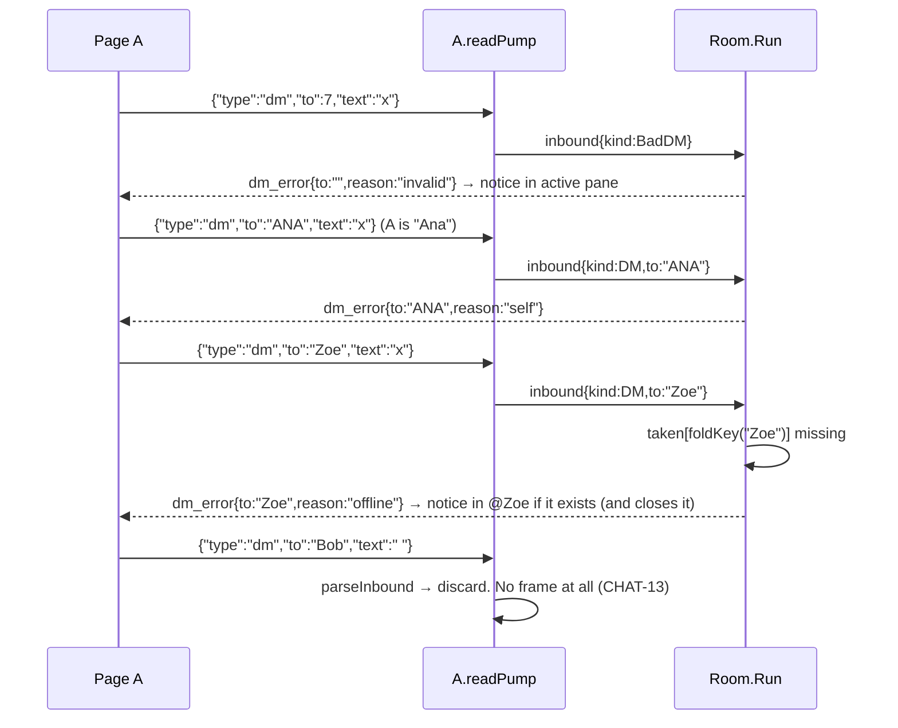

# Design: Private chat (direct messages)

## Technical Approach

A DM is one more kind of inbound frame that a room's single `Run` goroutine handles. The
hub invariants stay the same: only `Run` reads `clients`/`taken`/`history`, only `Run`
closes `send`, there are no locks and no cross-room state.

- **Read path (`client.go`, per connection goroutine).** `readPump` keeps the size limit,
  the binary check and the UTF-8 check exactly as they are today. It replaces the blank-frame
  check with one call to a pure function, `parseInbound(frame) (inbound, bool)`. That
  function does all JSON decoding and recipient normalization off the hub goroutine, and
  returns a tagged `inbound` (chat, DM, or invalid DM) or "discard" (blank). The result goes
  to the room's existing `broadcast` channel.
- **Hub (`room.go`, `Run` only).** `Run` and `drainBroadcast` call a new `dispatch(in)`. It
  checks that the sender is a member, then sends chat to the unchanged `relay`, a DM to
  `direct`, and an invalid DM to a `dm_error` reply. `direct` folds the recipient, rejects
  self, finds the member by `foldKey` (`taken` is the fast "offline" path, then a linear scan
  over `clients`), builds one `dm` frame, and queues it to the recipient and the sender with
  the existing non-blocking `deliver`. A client dropped as slow is announced with the same
  "dropped then leave" logic that `publish` uses, pulled out as `announceDropped`.
- **No server-side DM store.** After the server routes a DM, it keeps nothing. It never calls
  `remember`, never logs the DM, and never replays it. The page's in-memory transcript is the
  only copy (CHAT-24).
- **Page (`app.js`, `app.css`).** A top-level `conversations` Map, separate from `rooms`,
  holds one object per (room, peer nickname). Each object has its own tab, placed after the
  owning room's tab, its own `<ol>` pane, an unread count and an open/closed state. `active`
  keeps its meaning: the room that drives the header, status, users popover and "Dejar sala".
  A new `activeConv` (null or a conversation of `active`) chooses which pane is shown and
  where the composer sends. The page now sends JSON envelopes for both room chat and DMs.

This follows the proposal (room-scoped DMs routed in `Run`, envelope with a plain-text
fallback, `dm`/`dm_error` frames, a separate client structure) with one deliberate
difference: there is **no per-pair 50-message store and no purge on leave** (see the first
decision).

## Architecture Decisions

### Decision: No server-side DM store

**Choice**: The server routes each DM and forgets it. `Room` gets no new fields. There is no
per-pair store, cap or purge.
**Alternatives considered**: The proposal's store per `(foldKey(a), foldKey(b))`, capped at
50 and deleted when either side leaves.
**Rationale**: Nothing would read that store. The server never replays DMs (replay after
reconnect is out of scope, and so is offline delivery), so the store would be dead state. It
would also need its own purge logic in `remove`, which all three removal paths (unregister,
slow drop, shutdown) go through, and it would make it possible for content to outlive its
participants. Keeping nothing satisfies "never inherited by a reused nickname" by
construction, with no purge to get wrong (CHAT-24). "Kept in memory" is satisfied by the
page's transcript. This removes the proposal's "50-message cap" test and its "unbounded
pairs" risk.

### Decision: Reuse the `broadcast` channel with a tagged `inbound`, not a sibling channel

**Choice**: `inbound` gains `kind` and `to`. The zero value `kind` is chat, so every existing
`inbound{from: c, text: "…"}` literal in the tests still means room chat. `readPump` sends
every kind on `cr.broadcast`.
**Alternatives considered**: A new `direct chan inbound` with its own `select` case in `Run`.
**Rationale**: (1) **Ordering.** One reader feeds one FIFO channel, so a client's chat and DMs
are handled in the order they were sent. With two channels, `select` picks at random, and a
DM sent after a chat could be routed first. (2) **Drain-before-leave.** `leave` already
drains `broadcast` so a client's last frames are handled before its `leave` notice
(`TestChatBeforeLeaveOnDisconnect`). With one channel, DMs get that guarantee for free.
Otherwise both channels would need draining. (3) **Back-pressure and saturation** stay
exactly as today (`TestSaturationNoDeadlock` is unchanged). The cost is that the channel
name `broadcast` now also carries private traffic. A doc comment on the field records that.
Renaming it would touch about 15 test call sites for no behavior change.

### Decision: Parse in `readPump` with a pure `parseInbound`; look up the recipient in `Run`

**Choice**: `parseInbound(frame []byte) (inbound, bool)` in `message.go` does the JSON
decoding, type and field checks, the blank check and `cleanNickname(to)`. `Run` only does
`foldKey` plus a map lookup (and a scan of members when the name is taken).
**Alternatives considered**: Sending raw bytes to `Run` and decoding there. That puts JSON
decoding of up to 4 KiB per frame on the single hub goroutine, which serializes the whole
room behind it. Another option was to resolve the recipient in `readPump`, but that needs
`clients`, which only `Run` may read.
**Rationale**: The expensive, stateless work runs in parallel per connection, and `Run` stays
cheap. A pure function can be table-tested without sockets. Everything that needs room state
(membership, recipient, self) stays in `Run`.

### Decision: Exact-key JSON decoding into `map[string]json.RawMessage`

**Choice**:

```go
var env map[string]json.RawMessage
if json.Unmarshal(frame, &env) == nil { … env["type"], env["to"], env["text"] … }
```

A field counts as a string only when its raw value starts with `"` and decodes into a Go
`string` (helper `jsonString`).
**Alternatives considered**: Decoding into a struct with `json:"type"` tags.
**Rationale**: `encoding/json` matches struct tags **case-insensitively**, so `{"TYPE":"dm"}`
would become a DM. The spec says the `type` field is `type`. Map keys are exact.
`json.Unmarshal` into a `string` **accepts `null`** and leaves `""`, so `"to":null` would
look valid without the leading-`"` check (the spec requires `invalid`). Other cases fall
through naturally. Non-objects (`"x"`, `42`, `[…]`) fail to decode, so they are plain text.
`null` decodes to a nil map, and `env["type"]` is then missing, so it is also plain text.
With duplicate keys the last one wins (stdlib behavior). Extra fields are ignored. No new
dependency.

### Decision: Extract `cleanNickname` (CHAT-09 steps 1–4) from `normalizeNickname`

**Choice**: `nickname.go` gets `cleanNickname(s) string`, which makes the string valid UTF-8,
strips control and bidi characters, trims, truncates to 32 runes and may return `""`.
`normalizeNickname(s)` becomes `cleanNickname` plus the `"Anonymous"` fallback.
`parseInbound` calls `cleanNickname(to)`.
**Alternatives considered**: Calling `normalizeNickname` and treating `"Anonymous"` as empty.
That is wrong, because a user can really be named `Anonymous`. Copying the four steps into
`parseInbound` would create two normalizers that could drift apart.
**Rationale**: There are two real call sites, and the rule must be identical so that `to` and
assigned names fold the same way. The extraction is mechanical, and
`TestNormalizeNickname` keeps covering it.

### Decision: Recipient lookup by linear scan, with `taken` as the "offline" fast path

**Choice**:

```go
func (cr *Room) memberByKey(key string) *Client {
	if _, ok := cr.taken[key]; !ok {
		return nil
	}
	for c := range cr.clients {
		if foldKey(c.nickname) == key {
			return c
		}
	}
	return nil
}
```

**Alternatives considered**: Changing `taken` to `map[string]*Client`. It is O(1), but it
changes a field that `admit`, `remove`, `assignNickname` and about 8 white-box tests use
(`cr.taken[foldKey(n)] = struct{}{}`).
**Rationale**: Rooms are LAN-sized (tens of users), so a scan per DM costs nothing next to the
JSON encode. YAGNI. If rooms grow, the map change is local to `room.go`.

### Decision: Delivery reuses `deliver`; dropped clients are announced through `announceDropped`

**Choice**: Split `publish` into `fanOut` plus a new `announceDropped()`. Its body is the
existing loop: announce a leave for each `dropped` client, including cascades, then clear the
list. Private DM traffic uses:

```go
// deliverPrivate queues msg for each of cs and announces any dropped as slow. Run-only.
func (cr *Room) deliverPrivate(msg []byte, cs ...*Client) {
	for _, c := range cs {
		if _, ok := cr.clients[c]; ok && !cr.deliver(c, msg) {
			cr.dropped = append(cr.dropped, c)
		}
	}
	cr.announceDropped()
}
```

The recipient's copy goes first, then the sender's. A failed copy does not affect the other
copy (CHAT-22). The membership guard prevents a send on a closed channel. That cannot happen
today because the recipient and the sender are distinct members, but it costs nothing to
keep.
**Alternatives considered**: Calling `deliver` and ignoring drops. The dropped client would
then vanish without a `leave`, which breaks CHAT-02/05. Sending `dm_error offline` to the
sender instead of the echo when the recipient is dropped. That contradicts CHAT-22 ("does not
affect the other copy").
**Rationale**: This is the same slow-client semantics as every other frame and adds no new
removal path. `admit` keeps its own "newcomer dropped silently" handling and is unchanged.

### Decision: Separate outbound structs `dmFrame` and `dmErrorFrame`

**Choice**: Two new structs. The 4-field `message` is unchanged.
**Alternatives considered**: Adding `To`/`Reason` to `message` with `omitempty`. That breaks
CHAT-10's "exactly four fields, no omitempty" and the `decode` test helper.
**Rationale**: This follows the `usersFrame`/`historyFrame` precedent. Field order gives the
JSON order, and the exact shapes are asserted in tests. Because old test helpers (`decode`,
`readMsg`) reject unknown types and field counts, any DM that leaks to a third party makes
existing assertions fail loudly.

### Decision: The page keys conversations by exact assigned nickname, never by a folded key

**Choice**: `convKey(room, nick) = room.id + '\n' + nick`, using the exact string. `\n` can
never occur in a nickname (control characters are stripped) or in a room id
(`[a-z0-9-]`). The key lives only in the JS Map and never in the DOM.
**Alternatives considered**: A JS fold (`toLowerCase`) to imitate `foldKey`.
**Rationale**: The page only ever sees **assigned** names (`users`, `join`, `leave`, and
`dm.from`/`dm.to`, which the server canonicalizes), and the server already guarantees they are
unique under Go's fold within a room. Exact equality is therefore equivalent, and it avoids a
JS fold that does not match `unicode.SimpleFold` (final sigma, `ſ`, the Kelvin sign). If a
different-case name returns (`Ana` leaves and `ana` joins), it gets its own tab, which is
the right outcome when it may be a different person. `dm_error.to` is the normalized form of
what the page sent, and the page always sends an assigned name, so the lookup matches.

### Decision: `active` stays "the room"; a new `activeConv` selects the DM pane

**Choice**: `let activeConv = null;`, which is always null or a conversation whose `room` is
`active`. `current()` returns `activeConv || active` (the shown pane). Header, status pill,
users popover, `#me`, `updateLeaveBtn` and "Dejar sala" keep reading `active`.
**Alternatives considered**: Making `active` a union of room and conversation. Every `active.*`
use (status, ws, users, myName) would then need a "get the owning room" step, about 15 call
sites.
**Rationale**: A DM rides its room's socket, so the room's status and users are exactly what
the header should show while a DM tab is open. Only the pane, unread reset, composer target
and `#room-name` text depend on `activeConv`.

### Decision: The page sends JSON envelopes for room chat too

**Choice**: `{"type":"chat","text"}` in a room, `{"type":"dm","to","text"}` in a DM tab. The
4096-byte check runs on the **encoded** envelope.
**Alternatives considered**: Keeping plain text for room chat.
**Rationale**: If a user types text that happens to be a valid DM envelope, plain text would
route it as a DM. Wrapping it makes it chat. The cost is JSON escaping overhead (a message of
4096 `"` characters no longer fits). This is accepted because the server-side limit
(whole frame, CHAT-06) is unchanged, and the page already reports "El mensaje es demasiado
largo.".

## Data Flow

### Go types and constants (`message.go`)

```go
const (
	typeDM      = "dm"
	typeDMError = "dm_error"

	reasonInvalid = "invalid"
	reasonSelf    = "self"
	reasonOffline = "offline"
)

// dmFrame is a direct message, sent to the recipient and echoed to the sender.
type dmFrame struct {
	Type string `json:"type"` // always "dm"
	From string `json:"from"` // sender's assigned nickname
	To   string `json:"to"`   // recipient's assigned nickname
	Text string `json:"text"`
	TS   int64  `json:"ts"` // same in both copies
}

// dmErrorFrame tells only the sender why a direct message was not delivered.
type dmErrorFrame struct {
	Type   string `json:"type"`   // always "dm_error"
	To     string `json:"to"`     // cleaned requested recipient; "" for invalid
	Reason string `json:"reason"` // invalid | self | offline
	TS     int64  `json:"ts"`
}

type inboundKind uint8

const (
	inboundChat  inboundKind = iota // zero value: inbound{from, text} literals stay room chat
	inboundDM                       // to and text set
	inboundBadDM                    // dm envelope with a bad to/text; answered with dm_error invalid
)

// inbound is a classified client text frame on its way to the hub. It travels on
// Room.broadcast whatever its kind, so one client's frames keep their order.
type inbound struct {
	from *Client
	kind inboundKind
	to   string // inboundDM only: cleanNickname(to), never ""
	text string
}

// parseInbound classifies a size- and UTF-8-checked text frame (CHAT-21). ok is
// false when the frame must be discarded silently (CHAT-13). from is left for the caller.
func parseInbound(frame []byte) (in inbound, ok bool)

// jsonString reports whether raw is a JSON string and returns its value ("null" is not a string).
func jsonString(raw json.RawMessage) (string, bool) {
	if len(raw) == 0 || raw[0] != '"' {
		return "", false
	}
	var s string
	err := json.Unmarshal(raw, &s) // not `return s, json.Unmarshal(...) == nil`: s would be read first
	return s, err == nil
}
```

`parseInbound` logic. Order matters: an invalid DM is answered even when its text is blank.

```
env, isObject := unmarshal frame into map[string]json.RawMessage
typ, _ := jsonString(env["type"])
isObject && typ == "dm":
    to, toOK   := jsonString(env["to"]);  to = cleanNickname(to)
    text, txOK := jsonString(env["text"])
    !toOK || !txOK || to == ""   → {kind: inboundBadDM}, true
    TrimSpace(text) == ""        → discard (false)
    else                         → {kind: inboundDM, to, text}, true
isObject && typ == "chat" && text is a JSON string:
    blank → discard; else → {kind: inboundChat, text}, true
otherwise (plain text, non-object, unknown/missing type, chat with non-string text):
    blank whole frame → discard; else → {kind: inboundChat, text: string(frame)}, true
```

### `readPump` (`client.go`)

```go
// after the mt != TextMessage and !utf8.Valid checks, unchanged:
in, ok := parseInbound(message)
if !ok {
	continue // CHAT-13: blank, connection stays open
}
in.from = c
select {
case cr.broadcast <- in:
case <-cr.done:
	return
}
```

`client.go` drops its `strings` import, because the blank check moves into `parseInbound`.

### `Run` and handlers (`room.go`)

```go
case in := <-cr.broadcast:
	cr.dispatch(in)          // was cr.relay(in); drainBroadcast changes the same way

// dispatch routes a classified frame from a current member. Run-only.
func (cr *Room) dispatch(in inbound) {
	if _, ok := cr.clients[in.from]; !ok {
		return // removed; its name may belong to someone else now
	}
	switch in.kind {
	case inboundDM:
		cr.direct(in)
	case inboundBadDM:
		cr.dmError(in.from, "", reasonInvalid)
	default:
		cr.relay(in) // unchanged (keeps its own membership check; tests call it directly)
	}
}

// direct delivers a DM to its recipient and echoes it to the sender. It never stores or logs it.
func (cr *Room) direct(in inbound) {
	key := foldKey(in.to)
	if key == foldKey(in.from.nickname) {
		cr.dmError(in.from, in.to, reasonSelf)
		return
	}
	to := cr.memberByKey(key)
	if to == nil {
		cr.dmError(in.from, in.to, reasonOffline)
		return
	}
	if f := encode(dmFrame{typeDM, in.from.nickname, to.nickname, in.text, time.Now().UnixMilli()}); f != nil {
		cr.deliverPrivate(f, to, in.from)
	}
}

func (cr *Room) dmError(c *Client, to, reason string) {
	if f := encode(dmErrorFrame{typeDMError, to, reason, time.Now().UnixMilli()}); f != nil {
		cr.deliverPrivate(f, c)
	}
}

func (cr *Room) publish(msg []byte) { cr.fanOut(msg); cr.announceDropped() }
func (cr *Room) announceDropped()  { /* the loop currently at the end of publish, moved verbatim */ }
```

`Room`'s fields, `admit`, `leave`, `remove`, `remember`, `relay`, `fanOut`, `deliver` and
`serveConn` are unchanged. No log line in the DM path contains the text or the recipient.
`encode` logs only a marshal error, which is unreachable for these structs.

### DM delivery

```mermaid
sequenceDiagram
    participant PA as Page A (tab @Bob)
    participant RA as A.readPump
    participant H as Room.Run (general)
    participant WB as Bob.send / writePump
    participant WA as A.send / writePump
    participant C as C (same room)
    PA->>RA: {"type":"dm","to":"Bob","text":"hola"}
    RA->>RA: size/binary/UTF-8 → parseInbound → {kind:DM, to:"Bob"}
    RA->>H: broadcast <- inbound{from:A, kind:DM, to:"Bob", text}
    H->>H: dispatch: A member? yes → direct
    H->>H: foldKey("Bob") ≠ foldKey("A"); memberByKey → Bob
    H->>WB: deliver dm{from:A,to:Bob,text,ts}
    H->>WA: deliver same frame (echo)
    H->>H: announceDropped (no-op unless a copy overflowed)
    Note over H,C: no remember(), no fanOut, no log. C receives nothing
    WA-->>PA: dm (from == myName) → own bubble in @Bob
```

### Error path



### Peer leaves, then reopen

```mermaid
sequenceDiagram
    participant PA as Page A (@Bob open)
    participant H as Room.Run
    participant B as Bob
    participant B2 as new "Bob"
    B->>H: disconnect → unregister
    H->>H: leave(Bob): drainBroadcast (Bob's queued DMs to A dispatched first) → remove
    H-->>PA: leave{from:"Bob"}
    PA->>PA: users.delete; @Bob closed: "Bob se desconectó", composer disabled, transcript kept
    B2->>H: register (gets "Bob", no earlier DMs: server stored none)
    H-->>PA: join{from:"Bob"} → users.add (conversation stays closed)
    PA->>PA: user picks "Mensaje privado" on Bob in the popover
    PA->>PA: reopen @Bob: divider "Nueva conversación con Bob…", composer enabled, activate
    PA->>H: {"type":"dm","to":"Bob","text":"¿sos vos?"} → delivered to the new Bob
```

An incoming `dm` from `Bob` while `@Bob` is closed reopens it the same way, with the divider
before the message.

### Socket drop and reconnect

```
room.ws.onclose → scheduleReconnect(room)
  status reconnecting, "Conexión perdida, reconectando…" in the room pane (unchanged)
  closeConversations(room, 'Se perdió la conexión. Esta conversación terminó.')  ← new; open ones only
reconnect → welcome (myName may change) → users → history (room pane only; DM panes untouched, CHAT-18)
conversations stay closed until the user picks the peer again or a dm arrives
```

### Frontend data model and layout (`app.js`)

```js
const conversations = new Map(); // convKey(room, peer) -> conversation; DOM never sees the key
let activeConv = null;           // null, or a conversation of `active`
let convSeq = 0;                 // element ids: 'dm-tab-' + n / 'dm-pane-' + n (never the nickname)

const convKey = (room, nick) => room.id + '\n' + nick;
const current = () => activeConv || active;   // the pane on screen
const ownerRoom = (p) => p.room || p;         // conversation → its room; room → itself

// conversation: { room, peer, tab, nameEl, unreadEl, list, open: true, unread: 0, lastAuthor: null }
function createConversation(room, peer)  // builds tab + pane, inserts tab after the room's last tab, renders
function renderConvTab(conv)              // .closed toggle, badge (99+), aria-label
function openConversation(room, peer)     // popover action: require room.users.has(peer) && peer !== room.myName;
                                          // get or create, reopen if closed, activate(room, conv), closePanels, focus draft
function reopenConversation(conv)         // closed → open; addSystem divider; render; updateSendState
function closeConversation(conv, notice)  // open → closed; addSystem(notice); render; updateSendState if shown
function closeConversations(room, notice) // every open conversation of room
function removeConversations(room)        // tab.remove(), list.remove(), delete; activeConv = null if it was one
```

DOM, built with `createElement`/`textContent`. Nickname text appears only in `textContent`,
the `aria-label` value and the `placeholder` value. It never appears in ids, classes or
selectors:

```html
<!-- inserted right after #tab-general (or after general's previous DM tab) -->
<button type="button" role="tab" id="dm-tab-3" class="room-tab dm-tab joined"
        aria-selected="false" aria-controls="scroller" aria-label="@Bob, privado en #general, 2 sin leer">
  <span class="room-tab-name">@Bob</span><span class="room-unread">2</span>
</button>
<!-- appended to #scroller -->
<ol id="dm-pane-3" class="messages" aria-live="polite" hidden></ol>
```

The `aria-label` is `'@' + peer + ', privado en #' + room.id`, plus `', desconectado'` when
closed and `', N sin leer'` when unread is above 0. A closed tab gets the `.closed` class
(muted).

Function changes:

| Function | Change |
|----------|--------|
| `createRoom` tab click | `if (room === active && !activeConv) return;` then as today |
| `activate(room, conv = null)` | Sets `active`, `activeConv`. `aria-selected`/`hidden` across rooms **and** conversations against `current()`. `#scroller[aria-labelledby]` = `current().tab.id`. `#room-name` = `conv ? '@' + conv.peer + ' · #' + room.id : '#' + room.id`. Resets `current().unread` and renders its tab. Rest unchanged |
| `teardown(room)` | Also `removeConversations(room)` ("Dejar sala" and "Salir" both go through it) |
| `scheduleReconnect(room)` | Also `closeConversations(room, 'Se perdió la conexión. Esta conversación terminó.')` |
| `addRaw` `leave` | Also: conversation `convKey(room, from)`, if open → `closeConversation(c, from + ' se desconectó')` |
| `addRaw` `dm` (new, inside the `from`-is-string switch) | Requires `to`/`text` strings. `peer = from === room.myName ? to : (to === room.myName ? from : null)`, else ignore. Get or create (not activated), `reopenConversation` if closed, `addChat(conv, from, text, ts)`, `bumpUnread(conv)` if `conv !== current()` and not own |
| `addRaw` `dm_error` (new, **before** the `from` guard like `users`/`history`) | Requires `to`/`reason` strings. Target = `conversations.get(convKey(room, to))` when `to !== ''`, else `current()`. Notice text by reason: `offline` → `to + ' no está en la sala. El mensaje no se envió.'` (and `closeConversation` if open), `self` → `'No podés mandarte un mensaje privado.'`, otherwise → `'No se pudo enviar el mensaje privado.'` |
| `renderUsers()` | Each `li` other than `active.myName` appends a `<button type="button" class="btn btn-ghost users-dm">Mensaje privado</button>`, `aria-label` = `'Mensaje privado a ' + name`. The click closure captures `(room = active, name)` → `openConversation` |
| `addChat(pane, …)` / `addSystem(pane, …)` / `append(pane, …)` | Take a room **or** a conversation (both have `list`/`lastAuthor`). `own = author === ownerRoom(pane).myName`. Scroll and `img.onload` check `pane === current()` |
| `bumpUnread(p)` | `p.unread++`, then `renderConvTab` or `renderTab` |
| Room `chat` unread | `if (room !== current() && msg.from !== room.myName) bumpUnread(room)` (a room with its DM tab active counts) |
| `updateSendState()` | `online = active && active.status === 'online' && (!activeConv \|\| activeConv.open)`. `draft.placeholder` = `'Escribí algo…'` / `'Mensaje privado a ' + peer + '…'` / `peer + ' se desconectó'` |
| `sendText(text)` | Same socket guards on `active`. Return false if `activeConv && !activeConv.open`. `frame = JSON.stringify(activeConv ? {type:'dm', to: activeConv.peer, text} : {type:'chat', text})`. Byte check on `frame`, with the error notice in `current()`. `active.ws.send(frame)`. Nothing is rendered locally: the echo renders it |
| `renderHistory` | Unchanged: touches only `room.list` (CHAT-18: DM panes are never cleared) |

### File structure

```
internal/chat/
  message.go        + typeDM/typeDMError, reason*, dmFrame, dmErrorFrame, inboundKind, inbound.kind/to, parseInbound, jsonString
  nickname.go       + cleanNickname (normalizeNickname delegates)
  client.go         readPump calls parseInbound
  room.go           + dispatch, direct, dmError, memberByKey, deliverPrivate, announceDropped
  room_test.go      + hub DM tests and helpers
  client_test.go    + TestParseInbound, websocket DM tests
  server_test.go    + cross-room isolation test
cmd/chatroom/
  app.js            conversations, activeConv, envelopes, dm/dm_error handling
  app.css           .dm-tab, .closed, .users-dm
README.md           inbound envelope + dm/dm_error frames
```

## Testing

### Helpers (`room_test.go`)

- `dm(t, cr, from *Client, to, text string)` queues
  `inbound{from, kind: inboundDM, to: cleanNickname(to), text}`, with the same timeout
  pattern as `broadcast`.
- `exactFields(t, b []byte, keys ...string) map[string]json.RawMessage` requires a JSON
  object with exactly those keys. `frameFields` stays as it is.
- `expectDM(t, c, from, to, text string) dmFrame` reads with `nextRaw` and requires exactly
  `type,from,to,text,ts` and `type == "dm"`.
- `expectDMError(t, c, to, reason string)` requires exactly `type,to,reason,ts`.
- Existing `expect`/`next`/`expectEmpty`/`syncRoom` detect leaks for free: `decode` fails on
  any `dm`/`dm_error` frame.

### Helpers (`client_test.go`)

- `readDM(t, conn) dmFrame` and `readDMError(t, conn) dmErrorFrame` are the socket versions
  of the above (built on `readRaw` and `exactFields`).
- `send(t, conn, text)` is reused with literal JSON strings. `readMsg`/`readUntil`/`nextChat`
  on a third party fail if a DM reaches it.

### Test plan

| Test | File | Spec | Asserts |
|------|------|------|---------|
| `TestParseInbound` | client_test | CHAT-21, 13 | Table cases: `hola`→chat whole. `{"type":"chat","text":"hi"}`→chat `hi`. `{"type":"chat","text":"  "}`→discard. `{"type":"chat","text":5}` / `{"type":"chat"}` / `{"type":"typing"}` / `{"text":"x"}` / `[1,2]` / `"dm"` / `42` / `null` / `{"type":"dm"` (malformed) / `{"TYPE":"dm","to":"B","text":"x"}`→chat whole frame. `{"type":"dm","to":"B","text":"x"}`→DM `B`. `"to":"  bob‮ "`→`bob`. 40-rune `to`→32 runes. `"extra":1` ignored. `"from":"C"` ignored. Invalid: no `to`, `"to":""`, `"to":"   "`, `"to":"‮"`, `"to":7`, `"to":null`, no `text`, `"text":null`, `"to":7,"text":" "` (invalid wins over blank). `"to":"B","text":"\n"`→discard. `""`, `"  "`→discard |
| `TestDMDeliveredAndEchoed` | room_test | CHAT-22 | A, Bob, C registered. `dm(a,"  bob ","secreto")`: Bob then A get `dm{A,Bob,secreto}` with equal ts inside a before/after window. `syncRoom`-style marker from C shows C got nothing before the marker |
| `TestDMSuffixedRecipient` | room_test | CHAT-22 | Ana, Ana (2), A: DM to `Ana (2)` reaches only Ana (2) and A. `expectEmpty(ana)` after a sync marker |
| `TestDMErrors` | room_test | CHAT-23 | `inbound{kind: inboundBadDM}` → `dm_error{"",invalid}`. DM to `ANA` from `Ana` → `{ANA,self}`. DM to `Zoe` → `{Zoe,offline}`. B gets nothing. A still a member (a later broadcast reaches A) |
| `TestDMNotInHistory` | room_test | CHAT-24, 18 | A chats `hola`, DMs B `secreto`, B unregisters. New C: `expectHistory` = only `hola` |
| `TestReusedNicknameInheritsNothing` | room_test | CHAT-24 | A↔B DMs, B unregisters, new `b` registers: `expectWelcome` then its join, then `expectEmpty`. A DM to `B` now reaches `b` with `to` = `b` |
| `TestDMFromNonMemberDropped` | room_test | CHAT-22 | Like `TestBroadcastFromNonMemberDropped`: a DM from a slow-dropped client produces nothing (the sync chat comes first) |
| `TestDMBeforeLeaveOnDisconnect` | room_test | CHAT-02 (ordering) | No `Run`: queue `inbound{a, inboundDM, "b", "bye"}`, `cr.leave(a)`, then b gets the dm before `leave a` (proves `drainBroadcast` uses `dispatch`) |
| `TestDMSlowRecipientDropped` | room_test | CHAT-22, 05 | No `Run`: members o (16), a (16), x (buffer 0). `cr.dispatch(DM a→x)`: `expectClosed(x)`, a gets the echo then `leave x`, o gets only `leave x` |
| `TestDMNotLogged` | room_test | CHAT-24 | `log.SetOutput(&buf)` (restored in `t.Cleanup`), runs DM, self, offline and invalid. `buf` contains neither the texts nor the recipient names |
| `TestDMOverWebSocket` | client_test | CHAT-21, 22 | A, B, C dial. A sends a DM envelope. `readDM` on B and A (same ts). C sends `sync` and `nextChat(c)` is `sync` (a DM would fail `decode`) |
| `TestChatEnvelopeAndForgery` | client_test | CHAT-21 | `{"type":"chat","from":"Bob","text":"hi"}` → B gets `chat{A,hi}`. Non-envelope JSON frames (spec scenario list) → chat with the whole frame |
| `TestDMWhitespaceDiscarded` | client_test | CHAT-13 | `{"type":"chat","text":"  "}`, `{"type":"dm","to":"B","text":"\n"}`, then `hi`: the first frame A and B each read is `chat hi` |
| `TestInvalidDMKeepsConnection` | client_test | CHAT-23 | The 4 invalid frames from the spec → 4 `readDMError{"",invalid}`. Then a chat still works |
| `TestOversizedDMClosesSender` | client_test | CHAT-06 | `maxMessageSize=64`, DM envelope of 65 bytes → `expectReadError(a)`, `expectLeaveWithoutBroadcast(b,"A")` |
| `TestDMRoomScoped` | server_test | CHAT-19, 22 | A, B in general, B in juegos: A's DM to B reaches only general's B. A DM to a nick present only in juegos → `offline` |
| existing suites | all | CHAT-01…20 | Unchanged and green: plain-text chat, size, UTF-8, blank, ordering, saturation. `TestNormalizeNickname` covers `cleanNickname` through delegation |

`cmd/chatroom/main_test.go` needs **no change**. `TestImageHostsMirroredInJS` only matches
the `IMAGE_HOSTS` block, `TestStaticAssets` compares the served and embedded bytes, and
`index.html` is untouched, so the CSP, no-inline and markup tests stay as they are (SRV-05).
Gates: `gofmt`, `go vet ./...`, `go test -race ./...`.

### Manual UI checklist (no JS harness)

1. Two browsers, A and B, in `#general`. A's popover lists B with "Mensaje privado". A's own
   row (with "vos") has no button.
2. A clicks it. The `@B` tab appears right after `#general` and is active. The header shows
   `@B · #general`. The placeholder reads "Mensaje privado a B…".
3. A sends `hola`. A sees an own bubble after the echo. B (on `#general`) gets a `@A` tab with
   badge 1. `#general` shows nothing new. A third browser C sees nothing.
4. B opens `@A`, the badge clears, and B replies. A GIF URL renders inline in the DM.
5. While A is on `@B`, a room message in `#general` bumps `#general`'s badge.
6. B closes its tab. A's `@B` shows "B se desconectó", Enviar/GIF are disabled, the transcript
   is kept, and the placeholder reads "B se desconectó".
7. A new B joins. `@B` stays closed. A picks B in the popover: a divider notice, then the
   composer is enabled again. A message to the new B works. A DM from the new B into the
   closed tab also reopens it.
8. Kill the server. Every open DM shows the connection-lost notice. On restart the room shows
   "Reconectado", and DM transcripts survive the `history` frame.
9. "Dejar sala" on `#juegos` with a `@X` tab there removes the tab. "Salir" removes all DM
   tabs. Joining again starts clean.
10. Nicknames such as ``, `"]` and `a\nb` render as text in the
    tab, header, notices and popover. Devtools show no nickname in any id or class.
11. 560px viewport: DM tabs scroll inside the strip, and long nicknames are ellipsized.
12. Screen reader reads `@B, privado en #general, 1 sin leer` and `, desconectado`.
13. Regression pass over the multiple-rooms checklist (tabs, unread, Dejar sala disabled with
    one room, per-room reconnect).

## File Changes

| File | Action | Description |
|------|--------|-------------|
| `internal/chat/message.go` | Modify | `typeDM`, `typeDMError`, `reason*` constants. `dmFrame`, `dmErrorFrame`. `inboundKind` + `inbound.kind`/`inbound.to`. `parseInbound`, `jsonString`. Imports `strings` |
| `internal/chat/nickname.go` | Modify | Extract `cleanNickname` (CHAT-09 steps 1–4). `normalizeNickname` = clean + `Anonymous` |
| `internal/chat/client.go` | Modify | `readPump` uses `parseInbound` instead of the inline blank check. Drops the `strings` import |
| `internal/chat/room.go` | Modify | `Run`/`drainBroadcast` call `dispatch`. New `direct`, `dmError`, `memberByKey`, `deliverPrivate`. `publish` split into `fanOut` + `announceDropped`. Doc comment on `broadcast` (carries every inbound kind) |
| `internal/chat/room_test.go` | Modify | `dm`, `exactFields`, `expectDM`, `expectDMError` helpers. Hub DM tests above |
| `internal/chat/client_test.go` | Modify | `readDM`, `readDMError`. `TestParseInbound` and the WebSocket DM tests above |
| `internal/chat/server_test.go` | Modify | `TestDMRoomScoped` |
| `cmd/chatroom/app.js` | Modify | `conversations`/`activeConv`/`convSeq`, conversation lifecycle functions, `activate(room, conv)`, `dm`/`dm_error`/`leave` handling, popover button, envelope `sendText`, composer state, teardown/reconnect hooks |
| `cmd/chatroom/app.css` | Modify | `.room-tab.dm-tab .room-tab-name { max-width: 16ch; overflow: hidden; text-overflow: ellipsis }`, `.room-tab.dm-tab.closed { color: var(--color-neutral-600) }`, `.users-list .users-dm { margin-left: auto; flex: none; font-size: 12px }`. Existing tokens only |
| `README.md` | Modify | Inbound protocol (plain text, `chat`/`dm` envelopes), `dm`/`dm_error` frames and reasons, privacy note (not stored, room-scoped) |
| `cmd/chatroom/index.html` | No change | Tabs, panes and popover buttons are built in JS. The CSP/no-inline markup tests are unaffected |
| `cmd/chatroom/main_test.go` | No change | Checked: no assertion touches the changed `app.js` areas |

## Open Risks

- **Impersonation (known limitation).** Nicknames are unauthenticated, and look-alike names
  survive normalization (backlog M1). Whoever takes `Bob` after Bob leaves receives new DMs
  sent to "Bob". Mitigations: the server stores nothing, so nothing is inherited; the
  conversation closes on `leave`/disconnect; reopening shows the "may be someone else"
  divider. Real auth stays in the backlog.
- **The echo means "accepted by the server", not "received".** If the recipient's copy
  overflows, the sender still gets the echo, followed immediately by the recipient's `leave`,
  which closes the conversation. This is accepted and matches CHAT-22.
- **Envelope overhead.** The page's effective text limit drops below 4096 bytes when the text
  has characters that need escaping. The page reports it, and the server limit is unchanged.
- **Draft follows the pane.** Text typed in `#general` and sent after switching to `@B` goes
  privately to B, and the reverse. The placeholder names the target, which mitigates this.
  The same trade-off was already accepted for rooms.
- **"Dejar sala" while a DM tab is active leaves the owning room** and its DM tabs. This is
  consistent because DMs live on that room's socket, and it is in the checklist.
- **Tab strip crowding** with many DMs. It scrolls horizontally (existing behavior), and tabs
  have no close button (invalid inside `role=tab`, as decided in multiple-rooms). They
  disappear on "Dejar sala"/"Salir". A per-tab close is a follow-up if users ask for it.
- **The `broadcast` channel name** now carries private frames too. This is documented in a
  comment. A rename is deferred to avoid churn.
- **No JS tests.** Routing to the conversation and the own/peer choice rely on the manual
  checklist. Exact-key routing means there is no fold logic in JS to get wrong.
