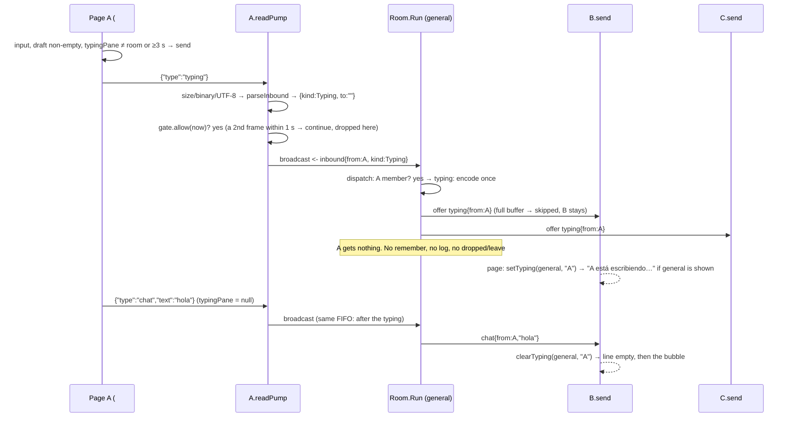

# Design: Typing indicator

## Technical Approach

A typing signal is one more kind of inbound frame that the room's single `Run` goroutine
handles. The rules for the hub stay the same: only `Run` reads `clients`/`taken`/`history`, only `Run`
closes `send`, there are no locks and no state shared between rooms. The signal has no stored state on
the server. Only the receiving page keeps state, as a small timer per typist.

- **Read path (`message.go`, `client.go`, one goroutine per connection).** `parseInbound` gets a
  `case typeTyping` that returns `inbound{kind: inboundTyping, to}`. `to == ""` means a room signal,
  and a non-empty value is a cleaned recipient. A malformed `to` makes it return `ok=false`, which
  is the same silent discard path as a blank frame (CHAT-13), so the hub never sees it.
  `readPump` then sends every typing inbound through a `typingGate` local to that connection
  (one forwarded per second, CHAT-26). Discarded frames stop there. Frames that pass go to
  `cr.broadcast` like any other kind, so one client's typing and chat frames stay in the order
  they were sent.
- **Hub (`room.go`, `Run` only).** `dispatch` gets one `case inboundTyping: cr.typing(in)`
  after its existing membership check. `typing` encodes one frame. A room signal goes to every
  member except the sender. A DM signal goes to `memberByKey(foldKey(to))` only, after the same
  self check as `direct`. Delivery goes through a new `offer` that **skips** a full buffer
  instead of removing the client. That keeps an ephemeral signal from ever producing a `leave`.
  No `remember`, no `dmError`, no log line.
- **Page (`app.js`, `index.html`, `app.css`).** Every pane (room or conversation) gets
  `typing: Map(nick → timeout id)`. A single `#typing` line between `#scroller` and `#send-form`
  shows the typists of `current()`. Outgoing signals come from one `notifyTyping()` that the
  draft `input` listener and the emoji buttons call. It reuses the composer's send guards and
  is throttled to 3 s per pane.

This follows the proposal exactly: start-only signal, 1 s server throttle, room fan-out
except the sender, DM to the recipient only, silent drops, best-effort delivery, never
stored or logged, CHAT-21 modified. It adds no new runtime dependency and no new channel.

## Architecture Decisions

### Decision: One `inboundTyping` kind; an empty `to` means "room"

**Choice**: Append one constant, `inboundTyping`, to the `inboundKind` iota. `inbound.to` is `""`
for a room signal and `cleanNickname(to)` (never `""`) for a DM signal.
**Alternatives considered**: (a) Two kinds, `inboundTyping` and `inboundTypingDM`. (b) A third
kind, `inboundBadTyping`, that the hub ignores.
**Rationale**: Typing is one signal with an optional target, and the hub handles it in one
function. One kind keeps `readPump`'s throttle check to a single comparison
(`in.kind == inboundTyping`) and `dispatch` to a single case. The empty value can't be misread:
`parseInbound` never returns a DM signal with an empty cleaned `to`, because that case is
discarded. A "bad typing" kind would only carry a frame into the hub so the hub could drop it.
`inboundBadDM` exists only because an invalid DM must be **answered** (`dm_error`). An invalid typing
signal needs no reply (CHAT-21 rule 2), so dropping it in `parseInbound` costs nothing on the
hub goroutine. Appending to the iota keeps every existing `inbound{...}` test literal valid.

### Decision: Exact `parseInbound` rules for `typing`

**Choice**: A new branch in the existing `switch typ`, placed between `typeDM` and `typeChat`:

```go
case typeTyping:
	// CHAT-21 rule 2: text is ignored and the blank rule does not apply.
	raw, hasTo := env["to"]
	if !hasTo {
		return inbound{kind: inboundTyping}, true // room signal
	}
	to, toOK := jsonString(raw)
	to = cleanNickname(to)
	return inbound{kind: inboundTyping, to: to}, toOK && to != "" // invalid: silent discard
```

| Input | Result |
|-------|--------|
| `{"type":"typing"}` | room signal |
| `{"type":"typing","text":"  "}`, `{"type":"typing","text":"hola"}`, `{"type":"typing","from":"C"}` | room signal (`text`/`from` ignored, no blank check) |
| `{"type":"typing","to":"  bob‮ "}` | DM signal, `to` = `bob` (CHAT-09 steps 1–4, 32-rune truncation) |
| `"to"` is `7`, `null`, `{}`, `""`, `"   "`, `"‮"` | discard (`ok=false`), no reply |
| `{"TYPE":"typing"}`, `{"type":"Typing"}` | not an envelope → room chat with the whole frame (exact keys, exact value) |

`"to":null` counts as "present and invalid", not as "absent". `jsonString` already rejects
`null`, and the key check uses map presence (`hasTo`), not the zero value.
**Alternatives considered**: Treating a present-but-invalid `to` as a room signal. That is
lenient, but a buggy page could then broadcast to the whole room a signal it meant for one person.
Falling back to plain chat for an invalid typing frame would contradict the spec and could put
JSON junk in the room.
**Rationale**: This reuses `jsonString` and `cleanNickname`, so a DM typing `to` folds exactly like a
DM `to` and like assigned names. Every decision that needs no state stays in the parallel,
table-testable function, as in the private-chat design.

### Decision: Per-connection throttle in `readPump`, as a tiny `typingGate` with an injected `now`

**Choice** (`client.go`):

```go
// typingInterval is the minimum time between two typing signals forwarded from one connection (CHAT-26).
const typingInterval = time.Second

// typingGate admits at most one typing signal per typingInterval. It belongs to a single
// readPump goroutine, so it needs no lock. A discarded signal does not move the window.
type typingGate struct{ last time.Time }

func (g *typingGate) allow(now time.Time) bool {
	if !g.last.IsZero() && now.Sub(g.last) < typingInterval {
		return false
	}
	g.last = now
	return true
}

// in readPump, before the loop:  var gate typingGate
// after parseInbound / !ok continue:
if in.kind == inboundTyping && !gate.allow(time.Now()) {
	continue // CHAT-26: over the per-connection budget; connection stays open
}
```

The gate runs **after** the read deadline refresh, so throttled frames still count for
liveness (CHAT-07). It also runs **after** `parseInbound`, so malformed typing frames never use up
the budget. Room and DM signals share one budget per connection, as the proposal says.
**Alternatives considered**: (a) Inline `lastTyping` plus `time.Now()` in `readPump`, tested only
over the socket. "Discarded signals don't reset the window" and the exact 1 s boundary would then
need sleeps of about 1 s, which is slow and flaky under `-race`. (b) A `typingInterval` field on `Room`
(the pattern `pongWait` uses) so tests could shorten it. That still needs real sleeps and timing
assumptions about when `readPump` reads each frame. (c) A token bucket. That's more than "one per
second" asks for.
**Rationale**: `allow` takes `now` as an argument, so `TestTypingGate` checks first-allowed,
within-window, boundary and no-reset with made-up `time.Time` values: deterministic and with no sleeps.
Production passes `time.Now()`, whose monotonic reading makes `Sub` immune to wall-clock jumps.
The over-the-socket test only has to show that two back-to-back frames yield one delivery, and
that is deterministic because they are microseconds apart. A package constant is enough because
nothing needs to configure it (YAGNI). The gate lives in the goroutine that reads the frames, so
the trust boundary needs no hub state and no lock.

### Decision: Best-effort `offer` that never removes a client

**Choice** (`room.go`):

```go
// offer queues msg for member c if its buffer has room and silently skips it otherwise.
// Unlike deliver it never removes c: a skipped typing frame is not a slow client. Run-only.
func (cr *Room) offer(c *Client, msg []byte) {
	select {
	case c.send <- msg:
	default:
	}
}
```

**Alternatives considered**: (a) Reusing `deliver`/`deliverPrivate`/`publish`. A full buffer would
then remove the client and announce `leave` because of a cosmetic signal, which breaks CHAT-26
"MUST NOT be disconnected". (b) A headroom rule ("skip if the buffer is more than half full") to
keep space for real messages. It is stricter than the spec, but it is a tuning knob for a problem
nobody has seen. A client whose 256-slot buffer is filling is already slow and will be dropped by
real traffic anyway.
**Rationale**: This is the smallest helper that expresses "best effort". Callers pass only current
members, from `cr.clients` or `memberByKey`, during a `Run` step that removes nobody, so `send` is
open and the write cannot panic. `dropped`/`announceDropped` are untouched.

### Decision: `typing` handler with an inline skip-sender loop and two outbound structs

**Choice**:

```go
// typingFrame tells room members that from is typing (CHAT-26). Never stored.
type typingFrame struct {
	Type string `json:"type"` // always "typing"
	From string `json:"from"`
	TS   int64  `json:"ts"`
}

// typingDMFrame tells only the recipient that from is typing to them (CHAT-26).
type typingDMFrame struct {
	Type string `json:"type"` // always "typing"
	From string `json:"from"`
	To   string `json:"to"` // recipient's assigned nickname
	TS   int64  `json:"ts"`
}

// typing relays an ephemeral typing signal: to the room except the sender, or to one
// recipient. Best effort; never stored, logged, answered or echoed. Run-only.
func (cr *Room) typing(in inbound) {
	ts := time.Now().UnixMilli()
	if in.to == "" {
		f := encode(typingFrame{typeTyping, in.from.nickname, ts})
		if f == nil {
			return
		}
		for c := range cr.clients {
			if c != in.from {
				cr.offer(c, f)
			}
		}
		return
	}
	key := foldKey(in.to)
	if key == foldKey(in.from.nickname) {
		return // self: silent (no dm_error)
	}
	to := cr.memberByKey(key)
	if to == nil {
		return // offline: silent
	}
	if f := encode(typingDMFrame{typeTyping, in.from.nickname, to.nickname, ts}); f != nil {
		cr.offer(to, f)
	}
}
```

`dispatch` adds `case inboundTyping: cr.typing(in)`. Its membership guard already drops
signals from removed clients, and `drainBroadcast` goes through `dispatch`, so a typing signal
queued before a disconnect is handled before the `leave`, as with chat.
**Alternatives considered**: (a) One struct with `To string \`json:"to,omitempty"\``. That breaks the
"no omitempty, exact shapes" convention (CHAT-10, `dmFrame` precedent). (b) A generic
`fanOutExcept(msg, skip)` helper. There is one caller, so the loop stays inline (YAGNI).
(c) Reusing `direct`'s lookup by refactoring it into a shared "resolve recipient" function. The two
paths differ only in what they do on failure (reply vs silence), and the shared part is two
lines that call existing functions.
**Rationale**: Field order sets the JSON order, and the exact shapes are asserted in tests. Like a
DM, `from`/`to` are the server's assigned names, never payload values. Existing test helpers
(`decode`, `readMsg`, `decodeDM`) reject a `typing` frame because the field count or type differs,
so any leak to the sender or a third party makes current assertions fail loudly.

### Decision: Page state is a `typing` Map on every pane plus one throttle slot

**Choice**:

```js
const TYPING_SEND_MS = 3000; // at most one outgoing signal per pane (CHAT-27)
const TYPING_TTL_MS = 5000;  // a typist disappears 5 s after its latest frame
let typingPane = null;       // pane our last signal was for; null = next edit signals at once
let typingSentAt = 0;        // performance.now() of that signal
// room and conversation objects both gain:  typing: new Map()  // nick -> timeout id
```

- `notifyTyping()`: return if `draft.value.trim() === ''`. Then `room = composerRoom()`
  (see below), and return if it is null. Then `pane = current()`. Return if
  `pane === typingPane && performance.now() - typingSentAt < TYPING_SEND_MS`. Otherwise set both
  slots and send `JSON.stringify(activeConv ? {type:'typing', to: activeConv.peer} : {type:'typing'})`.
  Comparing panes makes a pane switch signal right away (CHAT-27), with no extra hook.
- `composerRoom()`: extracted from `sendText`'s guards (`active`, `status === 'online'`, `ws`
  OPEN, `!activeConv || activeConv.open`). It returns `active` or null. It now has two callers,
  which is real duplication, so it's extracted.
- `sendText`: uses `composerRoom()`. After `room.ws.send(frame)` it sets `typingPane = null`.
  Receivers clear us when our chat or dm arrives, so the next keystroke has to signal again
  immediately. This also covers GIF sends, which go through `sendText`.
- Receiving:

```js
function setTyping(pane, nick)   // clearTimeout(old); map.set(nick, setTimeout(() => clearTyping(pane, nick), TYPING_TTL_MS)); render if pane === current()
function clearTyping(pane, nick) // no-op if absent; clearTimeout; delete; render if pane === current()
function clearAllTyping(pane)    // clearTimeout each; clear(); render if pane === current()
function renderTyping()          // $('typing').textContent = typingText([...current().typing.keys()])
function typingText(names)       // 0 → '' | 1 → `${a} está escribiendo…` | 2 → `${a} y ${b} están escribiendo…` | 3+ → 'Varias personas están escribiendo…'
```

  `Map` keeps insertion order, and re-setting an existing key keeps its place, so "Ana y Bob"
  never swaps order while both keep typing.

**Alternatives considered**: (a) One page-level `Map(convKey → …)` of typists. It needs a key
for room panes and an extra cleanup scan on every lifecycle path. (b) Storing a "last seen"
timestamp per typist and re-rendering with a 1 s interval timer. That's a polling loop for an
event that already arrives with its own timing. (c) Throttling with lodash-style debounce. That
would be a new dependency, and there is no build step.
**Rationale**: State lives on the object whose lifecycle already exists, so each cleanup hook is
one line. `setTimeout` per typist is bounded by the number of room members. `performance.now()`
is monotonic, so a clock change can't stall the throttle.

### Decision: Page hooks: where signals start, show and stop

**Choice**:

| Place | Change |
|-------|--------|
| `draft` `input` listener | `() => { updateSendState(); notifyTyping(); }` (typing and pasting) |
| emoji button click | after `draft.value += ch; updateSendState();` also `notifyTyping()`. Inserting an emoji is an edit (CHAT-27), and setting `.value` from code doesn't fire `input` |
| `addRaw` `case 'typing'` (new, inside the `from`-is-string switch) | Ignore if `msg.from === room.myName`. If `msg.to === undefined`, pane = `room`. Otherwise require `msg.to === room.myName` and `conv = conversations.get(convKey(room, msg.from))` to exist and be `open`, else ignore. Then `setTyping(pane, msg.from)`. **Never creates a conversation tab** |
| `addRaw` `case 'chat'` | `clearTyping(room, msg.from)` before `addChat` |
| `addRaw` `case 'dm'` | when `!own`: `clearTyping(conv, msg.from)` before `addChat` |
| `addRaw` `case 'leave'` | `clearTyping(room, msg.from)`. The peer's conversation is cleared by `closeConversation` (below) |
| `closeConversation(conv, …)` | `clearAllTyping(conv)`. This covers peer leave, connection loss (`closeConversations`) and a `dm_error offline` |
| `removeConversations(room)` | `clearAllTyping(conv)` before removing each one (no stray timers on detached panes) |
| `scheduleReconnect(room)` | `clearAllTyping(room)`. Its conversations are cleared by the existing `closeConversations` |
| `teardown(room)` ("Dejar sala", "Salir") | `clearAllTyping(room)`. Conversations are cleared through `removeConversations` |
| `joinRoom(room)` | No change. A room becomes `joined` only from its initial state or after `teardown`, and both leave its map empty |
| `activate(room, conv)` | `renderTyping()` (the visible pane changed) |

**Alternatives considered**: Showing a DM typist by creating (or reopening) the conversation
tab. A tab that pops up for a signal, maybe for a message that never comes, is noise, and
reopening would also show the "puede ser otra persona" divider for nothing. The real `dm` still
creates or reopens the tab as today.
**Rationale**: Every way a typist can become stale goes through an existing lifecycle function,
so the cleanup can't be skipped by a new path.

### Decision: `#typing` is a plain, fixed-height line outside the live regions

**Choice**: `index.html`: `<div id="typing" class="typing"></div>` between
`<div id="scroller" …>` and `<form id="send-form" …>`. There is no `role`, no `aria-live` and
nothing inline. CSS:

```css
/* base section, after the — messages — block */
.typing { flex: none; height: 20px; line-height: 20px; padding: 0 var(--gutter); font-size: 12px;
          color: var(--color-neutral-400); white-space: nowrap; overflow: hidden; text-overflow: ellipsis; }
/* chadroom retro block (appended at the end of the skin rules) */
.typing{height:22px;padding:4px 2px 0;font:11px/18px 'Courier New',monospace}
```

**Alternatives considered**: (a) Putting the line inside `#scroller` or the `<ol>`. That is
inside `aria-live=polite`, so screen readers would announce it every few seconds, and it would
scroll away. (b) `aria-live="polite"` on the line itself. It updates every 3–5 s while anyone
types, which is constant chatter. (c) `hidden` when empty. That makes the composer jump.
**Rationale**: A fixed height reserves the space (CHAT-27). The text is still reachable by
browsing for screen-reader users who look for it. `--color-neutral-400` instead of `-500`:
in the chadroom skin `#81566e` on the `#f4d2e3` window background is about 4.2:1, below AA for
11–12 px text, while `#794d68` is about 4.7:1. In the dark base skin both pass. Ellipsis keeps a
32-rune nickname to one line. `font` comes before `line-height` in the shorthand, so the
override is self-contained. The CSP is unchanged.

## Data Flow

### Wire shapes (`message.go`)

```go
const typeTyping = "typing"   // added to the existing const block

const (
	inboundChat  inboundKind = iota
	inboundDM
	inboundBadDM
	inboundTyping // to == "": room signal; else cleanNickname(to) of a DM signal
)

// inbound.to doc becomes: "inboundDM: cleanNickname(to), never ''. inboundTyping: '' for a room signal."
```

```
in : {"type":"typing"}                    {"type":"typing","to":"bob"}
out: {"type":"typing","from":"Ana","ts":…} {"type":"typing","from":"Ana","to":"Bob","ts":…}
     → every member except Ana             → Bob only
```

### Room typing



If no `chat` arrives, B's 5 s timer clears A. A page that keeps typing re-signals every 3 s,
so the indicator stays steady (3 s < 5 s TTL).

### DM typing

```mermaid
sequenceDiagram
    participant PA as Page A (tab @Bob)
    participant RA as A.readPump
    participant H as Room.Run
    participant WB as Bob.send
    participant C as C (same room)
    PA->>RA: {"type":"typing","to":"Bob"}
    RA->>RA: parseInbound → {kind:Typing, to:"Bob"} → gate.allow
    RA->>H: broadcast <- inbound
    H->>H: foldKey("Bob") ≠ foldKey("A"); memberByKey → Bob
    H->>WB: offer typing{from:A, to:Bob}
    Note over H,C: A and C get nothing
    WB-->>WB: page Bob: @A conversation exists and is open? → setTyping(conv, "A"), else ignore
    PA->>RA: {"type":"typing","to":"Zoe"} (offline) or {"to":"A"} (self) or {"to":7} (invalid)
    Note over RA,H: invalid: dropped in parseInbound. self/offline: dropped in typing(). No dm_error, no frame
```

### Page lifecycle

```
connection lost → scheduleReconnect: clearAllTyping(room); closeConversations → clearAllTyping(conv)
"Dejar sala"/"Salir" → teardown: clearAllTyping(room); removeConversations → clearAllTyping(conv)
peer leaves → leave: clearTyping(room, peer); closeConversation(@peer) → clearAllTyping
tab switch → activate → renderTyping() shows the new current() pane's typists
```

## Testing

### Helpers

- `room_test.go`: `typingSignal(t, cr, from *Client, to string)` queues
  `inbound{from, kind: inboundTyping, to: cleanNickname(to)}`, with the same timeout pattern as
  `dm`. `decodeTyping(t, b) typingDMFrame` checks `exactFields(t, b, "type","from","ts")` or with
  `"to"` (it decides by the presence of `to`) and requires `type == "typing"`.
  `expectTyping(t, c, from, to string)` requires `to` absent when `to == ""`.
- `client_test.go`: `readTyping(t, conn) typingDMFrame` = `decodeTyping(t, nextNonJoin(t, conn))`.
  Existing `nextChat`/`readMsg`/`expect` fail on any stray `typing` frame (the field count differs), so
  "nothing else arrived before the marker" checks come for free.

### Test plan

| Test | File | Spec | Asserts |
|------|------|------|---------|
| `TestParseInbound` (extend) | client_test | CHAT-21 | Row `unknown type` changes to `{"type":"poke"}`. New rows: `{"type":"typing"}` → `{kind: inboundTyping}`. `{"type":"typing","text":"  "}` and `"text":"hola"` → room signal (no blank rule, text dropped). `"from":"C"` ignored. `"to":"  bob‮ "` → `to: "bob"`. 40-rune `to` → 32. `"extra":1` ignored. Discard: `"to":7`, `null`, `{}`, `""`, `"   "`, `"‮"`. `{"TYPE":"typing"}` and `{"type":"Typing"}` → chat whole frame |
| `TestTypingGate` | client_test | CHAT-26 | Fixed `base := time.Unix(1000, 0)`: `allow(base)` true. `+999ms` false. `+1s` true (boundary). `+1.5s` false. `+2s` true (the discarded `+1.5s` did not move the window) |
| `TestTypingRoomExcludesSender` | room_test | CHAT-26 | A, B, C `joinAll`. `typingSignal(a, "")` → B and C `expectTyping("A", "")` with exactly 3 fields. `broadcast(a, "marker")` → A's first frame is the marker (no echo) |
| `TestTypingDirectRecipientOnly` | room_test | CHAT-26 | A, Bob, C. `typingSignal(a, "  bob ")` → Bob `expectTyping("A", "Bob")` with exactly 4 fields. Marker from C: A's and C's first frame is the marker |
| `TestTypingSelfAndOfflineSilent` | room_test | CHAT-26 | Ana, B. `typingSignal(ana, "ANA")`, `typingSignal(ana, "Zoe")`. Marker: Ana's and B's first frame is the marker (no `dm_error`, no typing) |
| `TestTypingFromNonMemberDropped` | room_test | CHAT-26 | Like `TestDMFromNonMemberDropped`, with a typing signal from the slow-dropped client |
| `TestTypingNotInHistory` | room_test | CHAT-26, 18 | A sends a typing signal, then `hola`. New C: `expectHistory` = only `hola` |
| `TestTypingFullBufferSkips` | room_test | CHAT-26, 05 | No `Run`: o (16), a (16), b (cap 1, pre-filled with `filler`). `cr.dispatch` room typing from a, then DM typing a→b. b is still in `cr.clients` and `cr.taken`. o gets exactly one typing frame, then `expectEmpty` (no `leave b`). b yields `filler` then `expectEmpty`. a `expectEmpty` |
| `TestTypingNotLogged` | room_test | CHAT-26 | `lockedBuffer` log sink. Dispatch room, DM (`Bea`), self and offline (`Zoe-offline`) typing. The log contains neither `Bea` nor `Zoe-offline` |
| `TestTypingOverWebSocket` | client_test | CHAT-21, 26 | A, B, C dial. A sends `{"type":"typing","from":"C"}` → B and C `readTyping` from `A`, no `to`. B sends `{"type":"typing","to":"a"}` → A `readTyping` `{from B, to A}`. Then C sends `sync`. `nextChat` on A, B and C returns `sync` first (no echo, no leak; a typing frame would fail `decode`) |
| `TestTypingThrottledOverWebSocket` | client_test | CHAT-26 | A sends `{"type":"typing"}` twice back to back, then `hola`. B: `readTyping` once, then `nextChat` = `hola` (a second typing frame would fail). A: `nextChat` = `hola` (the connection is still open) |
| `TestInvalidTypingDiscarded` | client_test | CHAT-21 | A sends `{"type":"typing","to":7}`, `{"type":"typing","to":"   "}`, then `hola`. A's and B's first frame is `chat hola` |
| `TestChatEnvelopeAndForgery` (edit) | client_test | CHAT-21 | Replace `{"type":"typing"}` with `{"type":"poke"}` in the non-envelope list (it matches the modified spec scenario) |
| `TestIndexHasTypingLine` | main_test | CHAT-27 | `index.html` contains `id="typing"`. The order is `id="scroller"` < `id="typing"` < `id="send-form"`. The `<div id="typing"…>` start tag has no `aria-live` and no `role` |
| existing suites | all | CHAT-01…25, SRV | Unchanged and green. `TestNewRoomDefaults` is unaffected (no new `Room` field). `TestIndexHasNoInlineCode`, the CSP and `TestImageHostsMirroredInJS` are unaffected |

Gates: `gofmt -l` (via `/snap/go/current/bin/gofmt`), `go vet ./...`, `go test -race ./...`.
No sleep longer than the existing helpers' deadlines is needed anywhere.

### Manual UI checklist (no JS harness)

1. Browsers A and B in `#general`. A types `h`: within about 1 s B's line reads "A está escribiendo…". A
   keeps typing for 10 s: the line stays steady (devtools on A: about one `typing` frame every 3 s).
2. A stops typing without sending: B's line clears about 5 s later. A sends: B's line clears when
   the bubble appears, and A typing again shows it again right away.
3. A third browser C types too: B reads "A y C están escribiendo…". With a fourth typist:
   "Varias personas están escribiendo…". A never sees its own name.
4. B switches to `#juegos`: the line is empty. B returns within 5 s: A's typing shows again.
5. DM: A opens `@B` and types. B, viewing `@A`, sees "A está escribiendo…". B on `#general` sees
   nothing there. C sees nothing anywhere. If B has no `@A` tab, no tab appears until A sends.
6. Emoji only: A clears the draft and inserts an emoji from the panel: B sees the indicator.
   Typing only spaces sends nothing.
7. A closes its tab while typing: B's line clears at once with "A salió". Kill the server:
   lines clear when "Conexión perdida" appears.
8. Nickname `` and a 32-character nickname type: the line shows them as
   text, truncated with an ellipsis on one line. No nickname appears in any id or class.
9. Both skins: the line keeps its height when empty (the composer doesn't move), muted and readable.
   At 480 px the composer wrap still works.
10. Screen reader: no announcements while someone types. The line can be reached by browsing.
11. Regression pass: DM checklist (open/close/reopen tabs, unread badges) and per-room reconnect.

## File Changes

| File | Action | Description |
|------|--------|-------------|
| `internal/chat/message.go` | Modify | `typeTyping`. `typingFrame`, `typingDMFrame`. `inboundTyping` kind, plus the `inbound.to` doc. `case typeTyping` in `parseInbound` |
| `internal/chat/client.go` | Modify | `typingInterval`, `typingGate` + `allow`. `readPump` declares a gate and discards typing frames over the budget after `parseInbound` |
| `internal/chat/room.go` | Modify | `dispatch` `case inboundTyping`. New `typing` (room fan-out except the sender, DM via `memberByKey`, silent self/offline) and `offer` (best effort, never removes) |
| `internal/chat/room_test.go` | Modify | `typingSignal`, `decodeTyping`, `expectTyping` helpers. Hub typing tests above |
| `internal/chat/client_test.go` | Modify | `readTyping`. `TestParseInbound` rows. `TestTypingGate`. WebSocket typing tests. `TestChatEnvelopeAndForgery` uses `{"type":"poke"}` |
| `cmd/chatroom/index.html` | Modify | `<div id="typing" class="typing"></div>` between `#scroller` and `#send-form` |
| `cmd/chatroom/app.js` | Modify | `TYPING_*` constants, `typingPane`/`typingSentAt`, `typing` Map on room and conversation objects, `composerRoom` (extracted from `sendText`), `notifyTyping`, `setTyping`/`clearTyping`/`clearAllTyping`/`renderTyping`/`typingText`, `addRaw` `typing` case and clears on `chat`/`dm`/`leave`, hooks in `activate`, `closeConversation`, `removeConversations`, `scheduleReconnect`, `teardown`, the draft `input` listener and emoji clicks. `sendText` resets the throttle |
| `cmd/chatroom/app.css` | Modify | Base `.typing` rule (existing tokens only) and the chadroom-skin override |
| `cmd/chatroom/main_test.go` | Modify | `TestIndexHasTypingLine` |
| `README.md` | Modify | Inbound table: `{"type":"typing"}` and `{"type":"typing","to":"bob"}`. The "cualquier otra cosa" row now excludes `typing`. Outbound table: `typing` row (no `text`; `to` only in DM). Short "Escribiendo…" paragraph: at most 1 per second per connection, to everyone except the sender or only to `to`, best effort, no reply to invalid/self/offline, not stored, not logged. Architecture line for `message.go` mentions `typing` |
| `cmd/chatroom/main.go` | No change | No CSP or route change |
| `internal/chat/server_test.go` | No change | Rooms are separate hubs. `typing` only iterates `cr.clients`, and the existing isolation tests cover the mechanism |
| `openspec/specs/chat/spec.md` | Modify at archive | Merge the delta (CHAT-21 modified, CHAT-26/27 added) when the change is archived |

## Open Risks

- **Shared per-connection budget.** Room and DM signals share 1/s. If a user types in `#general`
  and switches to `@Bob` and types within 1 s, the first DM signal is dropped by the server, and the
  page (whose 3 s throttle has already been reset for the new pane) re-signals at about 3 s. Bob sees the
  indicator up to about 3 s late, once. Accepted: it's cosmetic, and the budget is the trust boundary.
- **Buffer slots.** Typing frames take `send` slots (≤ 1/s per other member). For a client that
  is already slow, that can make the next real message the one that overflows. This is bounded,
  and the slow client would be dropped anyway. The headroom rule is the follow-up if it ever shows up.
- **Hub load.** A room signal is one encode plus an O(members) non-blocking loop, at ≤ 1/s per
  member. The `rate-limiting` backlog item still owns general flood control (chat frames are
  unthrottled, as today).
- **Activity disclosure.** Typing reveals presence and activity (including "is writing to you
  privately") to the recipient only. That's inherent to the feature. Nothing goes to third parties,
  history or logs.
- **Clock-free receivers.** Expiry uses the receiver's own timers, not `ts`, so clock skew between
  server and browser can't make a typist stick. `ts` is informational.
- **Nickname reuse.** A new "Bob" can't show a typing signal in an old `@Bob` pane: the pane closed
  on the old Bob's `leave`, and closed panes ignore typing until a real `dm` or the user reopens
  them, which shows the "puede ser otra persona" divider.
- **No JS tests.** Pane routing, timers and cleanup rely on the manual checklist. The logic sits in
  five small functions, and all cleanup goes through existing lifecycle hooks.
- **Mixed versions.** The page and the server are one binary and assets are served `no-cache`, so an
  old page that never sends `typing` and ignores unknown types is the only mixed case. It is harmless.
