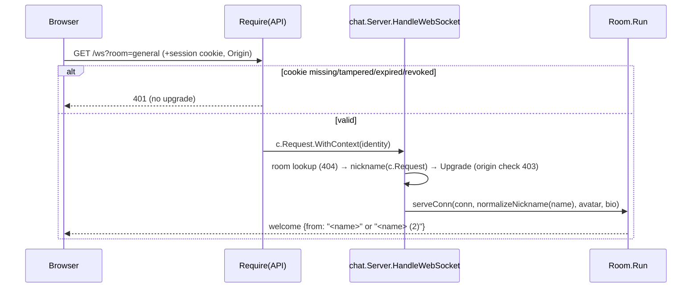

# Design: google-oidc-login

## Technical Approach

A new package `internal/auth` owns everything about identity: env config, signed cookies, the
OIDC login/callback/logout handlers, the `Require` gin middleware and a per-IP rate limiter.
`cmd/chatroom` wires it: it builds the auth handler at startup and refuses to serve if that fails.
It mounts `/auth/*` publicly and puts `Require` in front of the protected routes. It also gives
`chat.NewServer` a nickname resolver that reads the identity from the request context.
`internal/chat` never imports `auth`. It only gets a `func(*http.Request) string`.
The hub pattern stays as it is.

Only two libraries are added: `golang.org/x/oauth2` (authorization code + PKCE) and
`github.com/coreos/go-oidc/v3` (discovery, JWKS, ID-token verification). The rest is stdlib:
`crypto/hmac`, `crypto/sha256`, `crypto/subtle`, `crypto/rand.Text`, `encoding/base64`, `encoding/json`.
That covers cookies, the rate limiter and the test fake provider.

## Architecture Decisions

### Decision: Handler owns OIDC and builds Sessions; Sessions owns cookies and the middleware

**Choice**: Two exported types. `*auth.Sessions` signs and verifies session cookies, holds the
revocation set and provides `Require(mode)`. `*auth.Handler` holds the oauth2 config, the
go-oidc verifier, the flow-cookie sealer and the rate limiter, plus a `*Sessions` it creates
from the config. `auth.New` runs OIDC discovery against `cfg.Issuer`. Tests point that at an
httptest fake provider.
**Alternatives considered**: (a) A single `Auth` type: tests could not mint a cookie without
running discovery. (b) Hard-coding Google's endpoints through `oidc.ProviderConfig` to avoid
network at startup: that is brittle and also bypasses issuer discovery checks.
**Rationale**: `cmd/chatroom` tests can mint valid cookies with `auth.NewSessions` using the
same secret. That covers the `run()` tests, which build their own Handler internally. Everything
that needs a provider goes through one constructor that takes an issuer URL.

### Decision: Discovery happens at startup inside `run`; failure exits 1

**Choice**: `main` calls `auth.LoadConfig(os.Getenv)`. A config error is logged with variable
names only and the process exits 1 before listening. `run` calls `auth.New(ctx, cfg.auth, denied)`.
If that fails (bad config or discovery failure), it logs, closes `ln` and returns 1.
The provider context carries `&http.Client{Timeout: 10 * time.Second}` through
`oidc.ClientContext`. go-oidc copies only that client into the context it keeps for JWKS
refreshes, so later key fetches also time out.
**Alternatives considered**: Lazy discovery on first login, which turns a misconfigured issuer
into a runtime 500 instead of a startup error.
**Rationale**: This matches the "never run with auth silently broken" goal. Startup needs to
reach `accounts.google.com`. That is acceptable and documented.

### Decision: Stateless HMAC cookies with key separation per purpose

**Choice**: There are two cookie kinds, *session* and *flow*. They use the same format with
different keys derived from `SESSION_SECRET`:

    kSession = HMAC-SHA256(SESSION_SECRET, "go-chatroom/session/v1")
    kFlow    = HMAC-SHA256(SESSION_SECRET, "go-chatroom/oidc-flow/v1")
    value    = b64url(json(payload)) "." b64url(HMAC-SHA256(k, b64url(json(payload))))

`b64url` is `base64.RawURLEncoding`, so the value only uses cookie-safe characters. The MAC
covers the exact encoded payload bytes.

Verification order:
1. Reject values longer than 4096 bytes.
2. Split at the single `.`; it must produce exactly 2 parts.
3. Decode the MAC and compare with `hmac.Equal`. This happens before any JSON decoding.
4. Decode JSON and check `v == 1`.
5. Check `now < exp`.
6. Check purpose-specific fields (session: `sid` not revoked, `email` non-empty).

An unexported `sealer{key []byte}` with `seal(v any) (string, error)` and
`open(s string, v any) error` implements this. It is used exactly twice.

- Session payload: `{"v":1,"sid":<rand.Text()>,"email":"…","name":"…","exp":<unix>}`
- Flow payload: `{"v":1,"state":…,"nonce":…,"verifier":…,"next":"/…","exp":<unix>}`

`state`, `nonce` and `sid` come from `crypto/rand.Text()` (128 bits). `verifier` comes from
`oauth2.GenerateVerifier()`.
**Alternatives considered**: (a) A server-side session store. That adds state, and logout is
the only reason to have one. (b) Encrypting cookies (AES-GCM). The payloads hold no secrets
the holder does not already know. The PKCE verifier protects against code interception, not
against someone who can already read the victim's HttpOnly cookies.
(c) One key plus a `purpose` field. Separate keys make cross-use impossible by construction
rather than by a field check.
**Rationale**: This is the smallest stateless design the proposal allows. Constant-time
comparison and MAC-before-parse keep the attack surface to one `hmac.Equal`.

### Decision: Cookie names and attributes come from config, not from the request

**Choice**: `Secure` is `cfg.SecureCookies()`, which is true when the `OIDC_REDIRECT_URL`
scheme is `https`. It is computed once. Request scheme and proxy headers are never consulted;
proxies are untrusted (SRV-05).

| Cookie | secure=true name | secure=false name | Path | Max-Age | Attributes |
|---|---|---|---|---|---|
| session | `__Host-chat_session` | `chat_session` | `/` | `SESSION_TTL` | HttpOnly, SameSite=Lax, no Domain |
| flow | `__Secure-chat_oidc` | `chat_oidc` | `/auth` | 600 s | HttpOnly, SameSite=Lax, no Domain |

The flow cookie cannot use `__Host-` because that prefix requires `Path=/`. Deleting a cookie
writes it again with the same name, path and attributes and `MaxAge: -1`.
**Alternatives considered**: `SameSite=Strict`. The callback is a cross-site top-level
navigation from Google, so the flow cookie would not be sent. The session cookie would also be
missing on the first navigation from links in other sites.
**Rationale**: `__Host-` stops a sibling subdomain from setting or shadowing the session cookie
in production. Lax is the strictest value the OAuth redirect works with.

### Decision: Authorization only after full cryptographic validation; 400 vs 403 split

**Choice**: Any integrity or protocol failure gets **400** with a generic plain-text body. Only
a correctly verified ID token for an account outside the policy gets **403** with the denied
page. See "Callback validation order" below.
**Alternatives considered**: (a) 403 for everything. That mixes "your request is broken, retry"
with "your account is not allowed". (b) 502 when the token endpoint is down. That is accurate
but gives no useful user action and needs `RetrieveError` inspection.
**Rationale**: The two remedies differ: retry versus use another account. Neither status code
reveals anything an attacker could use, because nothing reaches the authorization step without
a valid state, code, PKCE verifier, signature and nonce.

### Decision: `chat.NewServer` takes a required nickname resolver

**Choice**:
```go
// NicknameFunc returns the raw display name for a WebSocket request; the chat
// package normalizes it (cleanText, "Anonymous", CHAT-12 suffixing).
type NicknameFunc func(r *http.Request) string

func NewServer(allowedOrigins []string, validAvatar func(string) bool, nickname NicknameFunc, rooms ...*Room) *Server
```
A nil `nickname` panics, like the existing room-id checks. `HandleWebSocket` replaces
`c.Query("nickname")` with `s.nickname(c.Request)`, called before the upgrade. Everything else
stays the same: avatar, bio, origin check, 404 for an unknown room.
In chat tests, a `queryNickname` helper (`r.URL.Query().Get("nickname")`) in `client_test.go`
is passed at the 5 `NewServer` call sites (`startAvatarRooms`, `client_test.go:432`,
`server_test.go:47,161,212`). All other dial helpers keep using `?nickname=` unchanged.
**Alternatives considered**: (a) nil means "read `?nickname=`". A wiring slip would silently
re-enable impersonation in production. (b) A `SetNickname` setter. That breaks the "Server is
never modified after NewServer" invariant.
**Rationale**: Secure by default, with five one-token edits in tests.

### Decision: `newRouter` takes a nil-able `*auth.Handler`; production can never pass nil

**Choice**: The signature becomes
`newRouter(chatSrv, gifs, playlists, a *auth.Handler)` and the same for `newRouterLogging`.
When `a == nil`, routes have no auth middleware and `/auth/login|callback|logout` are not
registered. `/auth/signed-out` is always registered. This mode exists only for the existing
tests. `run` is the only production caller. It returns 1 when `auth.New` fails, so it never has
a nil handler. `TestRunRequiresSession` proves that end to end: it runs `run()`, then gets `/`
→ 302 and `/ws` → 401.
`newChatServer(allowedOrigins, nickname chat.NicknameFunc)`:
- Production passes `identityNickname`, which returns `auth.IdentityFrom(r.Context())`'s `Name`,
  or `""` if there is no identity (unreachable behind `Require`; that would join as "Anonymous").
- Tests pass a `queryNickname` helper.

**Alternatives considered**: A required handler in every router test. That touches ~25 tests
for no gain.
**Rationale**: The proposal asked for minimal churn and a test that proves production wiring.

### Decision: Logout = POST + SameSite=Lax + Origin check; idempotent

**Choice**: `POST /auth/logout`:
1. If an `Origin` header is present and it is `null`, unparsable, or its host differs
   (case-insensitive) from `r.Host`, return **403**.
2. If the session cookie verifies, revoke its `sid` until its `exp`.
3. Always delete the session cookie.
4. Return **204** with `Cache-Control: no-store`.

There is no CSRF token.
**CSRF analysis**:
- A cross-site form or fetch POST does not carry a Lax cookie, so nothing is revoked. Clearing
  the cookie also fails, because the attacker's response cannot set it.
- A same-site but cross-origin POST (sibling subdomain in prod) would carry the cookie. The
  Origin check blocks it. Browsers always send Origin on POST.
- A missing Origin means a non-browser client, which would need the cookie anyway.
- Worst case is a forced logout, which is low impact.

**Alternatives considered**: (a) A double-submit CSRF token, which needs a token endpoint and
JS plumbing to stop a nuisance attack. (b) GET logout, which is prefetchable and open to
cross-site requests.
**Rationale**: It costs ~10 lines and closes the one realistic vector. `form-action 'none'`
stays valid because logout is a `fetch` POST, not a form submit.

### Decision: Hand-rolled fixed-window rate limiter on `/auth/login` + `/auth/callback`

**Choice**: An unexported `rateLimiter{mu sync.Mutex; limit int; window time.Duration;
now func() time.Time; hits map[string]*windowCount}`. The key is `c.ClientIP()`, which is the
remote address since there are no trusted proxies. The limit is 20 requests per IP per minute,
shared by both routes.
- Over the limit: **429**, `Retry-After: 60`, text body.
- When the map reaches 4096 keys, expired windows are pruned. If it is still full, new keys get
  429 (fail closed, bounded memory).

The mutex is fine here because this is not the hub.
**Alternatives considered**: `golang.org/x/time/rate`, which is a new dependency, and a
per-key token bucket isn't needed.
**Rationale**: A login takes 2 requests. 20/min allows retries and tabs, and it caps abuse of
the outbound token exchange.

### Decision: Replace `gin.Recovery()` with a minimal recovery that never dumps headers

**Choice**: In `main.go`, add `recoverPanics(c *gin.Context)`: defer/recover, log the panic
value and stack, then `AbortWithStatus(500)`.
**Rationale (security finding)**: gin's recovery dumps the request with `httputil.DumpRequest`.
It masks only `Authorization`, not `Cookie`, and it prints the headers in debug mode, which is
the default here, and on broken pipes. Any panic would write the session cookie to the logs.
Confirm against gin v1.12 source during apply. If gin no longer prints headers, keep the swap
anyway, since it is 8 lines.

## Data Flow

### Login / callback

```mermaid
sequenceDiagram
  participant B as Browser
  participant S as chatroom (gin)
  participant G as Google (issuer)
  B->>S: GET / (no/invalid session)
  S-->>B: 302 /auth/login?next=%2F  (Cache-Control: no-store)
  B->>S: GET /auth/login?next=%2F   [rate limit]
  Note over S: state, nonce = rand.Text(); verifier = GenerateVerifier()<br/>next = safeNext(q.next)
  S-->>B: 302 accounts.google.com/o/oauth2/v2/auth?client_id&redirect_uri&scope=openid email profile<br/>&state&nonce&code_challenge(S256)&hd=crombie.dev<br/>Set-Cookie flow={state,nonce,verifier,next,exp=+10m} (Path=/auth)
  B->>G: authorize (user signs in)
  G-->>B: 302 /auth/callback?code&state
  B->>S: GET /auth/callback?code&state  (+flow cookie)   [rate limit]
  Note over S: clear flow cookie (always) — validate steps 1..13
  S->>G: POST token endpoint (code, code_verifier, client auth)
  G-->>S: {access_token, id_token}  (access token discarded)
  Note over S: Verify id_token (sig/iss/aud/exp) · nonce · claims · policy
  S-->>B: 302 next   Set-Cookie session={sid,email,name,exp}
  B->>S: GET /  (+session) → 200
```

### WebSocket upgrade



## `internal/auth` API

```go
package auth

const GoogleIssuer = "https://accounts.google.com"

type Config struct {
	Issuer        string        // GoogleIssuer from LoadConfig; tests use a fake provider URL
	ClientID      string        // GOOGLE_CLIENT_ID (required)
	ClientSecret  string        // GOOGLE_CLIENT_SECRET (required)
	RedirectURL   string        // OIDC_REDIRECT_URL, default http://localhost:8080/auth/callback
	AllowedDomain string        // ALLOWED_EMAIL_DOMAIN, default crombie.dev, stored lowercase
	SessionSecret []byte        // SESSION_SECRET (required, >= 32 bytes)
	SessionTTL    time.Duration // SESSION_TTL, default 12h, 5m <= ttl <= 168h
}

// LoadConfig reads and validates the env; errors name variables, never values (errors.Join of all problems).
func LoadConfig(getenv func(string) string) (Config, error)
func (c Config) SecureCookies() bool // RedirectURL scheme == "https"

type Identity struct{ Email, Name string } // Name is already the display name (see callback step 14)
func IdentityFrom(ctx context.Context) (Identity, bool)

type Mode int
const (
	Page Mode = iota // failure → 302 /auth/login?next=<RequestURI>
	API              // failure → 401, empty body
)

type Sessions struct{ /* key, ttl, secure, now func() time.Time, mu, revoked map[string]time.Time */ }
func NewSessions(secret []byte, ttl time.Duration, secure bool) *Sessions
func (s *Sessions) Cookie(id Identity) (*http.Cookie, error) // mints a session cookie (callback + tests)
func (s *Sessions) Require(mode Mode) gin.HandlerFunc       // sets Identity in c.Request's context

type Handler struct{ /* cfg, sessions, oauth2.Config, *oidc.IDTokenVerifier, flow sealer, limiter, http client, denied, now */ }
// New validates cfg, runs discovery on cfg.Issuer, builds Sessions. denied writes the 403 page (nil: text 403).
func New(ctx context.Context, cfg Config, denied gin.HandlerFunc) (*Handler, error)
func (h *Handler) Sessions() *Sessions
func (h *Handler) Register(g *gin.RouterGroup) // on "/auth": GET login, GET callback (both rate-limited), POST logout
```

Unexported helpers: `verify(r) (session, bool)`, `revoke(sid, exp)` (prunes expired entries on
each call), `sealer`, `rateLimiter`, `safeNext(string) string`,
`emailInDomain(email, domain string) bool`, `asciiEqualFold`.

The clock is an unexported `now func() time.Time` field on `Sessions`, `Handler` and
`rateLimiter`, defaulting to `time.Now`. Package-internal tests overwrite it. The verifier gets
`oidc.Config{ClientID: cfg.ClientID, Now: h.now}`.

Config validation, beyond the required values and the secret length:
- `OIDC_REDIRECT_URL` must parse as an absolute URL with scheme `http` or `https`, a non-empty
  host, path `/auth/callback`, and no query or fragment.
- `ALLOWED_EMAIL_DOMAIN` must be non-empty ASCII with no `@` or whitespace. It is lowercased.
- `SESSION_TTL` must parse with `time.ParseDuration` and fall within the bounds above.

`New` re-runs validation so a hand-built `Config` cannot skip it.

Login request: scopes `openid email profile`, plus `oauth2.S256ChallengeOption(verifier)`,
`oidc.Nonce(nonce)` and `oauth2.SetAuthURLParam("hd", domain)`. The `hd` parameter is only a
UX hint for Google's account picker. Offline access is not requested. The token exchange uses
`context.WithValue(c.Request.Context(), oauth2.HTTPClient, h.client)` (10 s timeout) and
`oauth2.VerifierOption(verifier)`.

## Callback validation order

Every response sets `Cache-Control: no-store` and deletes the flow cookie, before anything else.

| # | Check | Failure | Log line (`auth: callback rejected: …`) |
|---|---|---|---|
| 0 | per-IP rate limit (middleware) | 429 | none |
| 1 | flow cookie present, MAC ok, `v`, not expired | 400 | `flow` |
| 2 | `state` query == flow.state (`subtle.ConstantTimeCompare`, non-empty) | 400 | `state` |
| 3 | `error` query empty (e.g. user cancelled → `access_denied`) | 400 | `provider_error` |
| 4 | `code` query non-empty | 400 | `code` |
| 5 | `Exchange(code, VerifierOption)` ok | 400 | `exchange status=<n> code=<oauth error code>` if `*oauth2.RetrieveError`, else `exchange transport`. Never `err.Error()`, since it may embed the response body. |
| 6 | `token.Extra("id_token")` is a non-empty string | 400 | `no_id_token` |
| 7 | `verifier.Verify` (signature via JWKS, `iss`, `aud`=client id, `exp`) | 400 | `verify` (no error text) |
| 8 | `idToken.Nonce` == flow.nonce (constant time) | 400 | `nonce` |
| 9 | `idToken.Claims(&{email, email_verified bool, name, hd})` decodes | 400 | `claims` |
| 10 | `email_verified == true` | 403 denied page | `unverified_email` |
| 11 | `emailInDomain(email, domain)` | 403 denied page | `domain=<part after @>` (never the full address) |
| 12 | `asciiEqualFold(hd, domain)` (missing `hd` fails) | 403 denied page | `hd` |
| 13 | mint session (`Cookie`) | 500 | `session` |
| 14 | `Identity{Email: lower(email), Name: displayName}` → Set-Cookie → `302 safeNext(flow.next)` | — | none |

The 400 body is plain text: "Solicitud de inicio de sesión inválida o vencida. Volvé a entrar
desde el inicio." There is no variation per step.

`emailInDomain`: `i := strings.LastIndexByte(email, '@')`. It requires `i > 0` and
`asciiEqualFold(email[i+1:], domain)`. `asciiEqualFold` only folds `A–Z`, so Unicode
look-alikes such as KELVIN SIGN do not match. Results: `evilcrombie.dev` fails,
`crombie.dev.evil.com` fails, `sub.crombie.dev` fails.

`displayName`: the `name` claim, trimmed and truncated to 64 runes. If empty, the email local
part. The chat package normalizes further to 32 runes, strips controls and bidi characters, and
applies CHAT-12 suffixing.

Logging rules: never log cookies, codes, tokens, state, nonce, verifier, client secret or
session secret, or full emails. The access log already strips the query string (`logFormatter`),
so `?code=&state=` never reaches it. Successful logins are not logged; an audit trail is backlog.

Two tabs that start login at the same time overwrite each other's flow cookie, and the earlier
callback fails at step 2 (400, retry works). This is accepted.

## Open-redirect-safe `next`

`safeNext(s)` returns `s` only if all of these hold. Otherwise it returns `"/"`.
- `1 <= len(s) <= 512`, and `s[0] == '/'`
- `s` does not start with `//`, and has no `\` anywhere (browsers treat `/\` as `//`)
- no ASCII control characters or spaces
- `url.Parse(s)` succeeds with empty `Scheme`, `Host` and `User`
- the path is not `/auth` or under `/auth/` (no login loops)

It runs at `/auth/login`, before `next` is sealed into the flow cookie, and again at the
callback, before `c.Redirect(302, next)` (defense in depth). `Require(Page)` builds
`next = c.Request.URL.RequestURI()`. Today that is always `/`.

## Router layout (`cmd/chatroom/main.go`)

```go
r := gin.New()
r.Use(gin.LoggerWithConfig(...), recoverPanics)
page, api := noop, noop                        // a == nil: tests only
if a != nil {
	page, api = a.Sessions().Require(auth.Page), a.Sessions().Require(auth.API)
}
// protected
r.GET("/", page, servePage)
r.GET("/app.js", api, serveAsset(js, appJS))   // a script fetch can't follow a login redirect: 401
r.GET("/rooms", api, serveRooms)
r.GET("/ws", api, chatSrv.HandleWebSocket)     // 401 before the upgrade
if gifs != nil      { r.GET("/gifs", api, gifs.handle) }
if playlists != nil { r.GET("/playlist", api, playlists.handle) }
// public
r.GET("/app.css", ...); r.GET("/favicon.svg", ...); r.GET("/favicon-unread.svg", ...)
ag := r.Group("/auth")
ag.GET("/signed-out", serveAuthPage(http.StatusOK, signedOutHTML))
if a != nil { a.Register(ag) }
```

- `serveAuthPage(status, body)` sets `nosniff`, `Cache-Control: no-store`,
  `X-Frame-Options: DENY`, `Referrer-Policy: no-referrer` and
  `Content-Security-Policy: authPageCSP`, then writes the body. `run` passes
  `serveAuthPage(http.StatusForbidden, deniedHTML)` as `denied` to `auth.New`.
- `authPageCSP = "default-src 'none'; style-src 'self'; img-src 'self'; base-uri 'none'; form-action 'none'; frame-ancestors 'none'"`.
  It has no `script-src`, `connect-src` or `frame-src`, because these pages are plain links.
- `Require` failures set `Cache-Control: no-store`. The `no-cache` on `/` stays, which forces
  revalidation through the middleware.
- `Secure` and the cookie names come from config only (see the cookie decision). `/auth/login`
  never inspects `r.TLS` or `X-Forwarded-Proto`.
- The main page's CSP is unchanged. The redirect to Google is a navigation, and logout is a
  fetch to `'self'`, so `connect-src 'self'` and `form-action 'none'` both hold.
- `config` gets a field `auth auth.Config`. `main()` loads it before `serve`.

## Frontend changes

`index.html`:
- Replace `#join-view` (form, `#nick`, `#join-btn`, `#join-error`) with
  `<section id="start-view" class="view join">`. It contains the brand block,
  `<p id="start-status">Conectando…</p>`,
  `<p id="start-error" class="join-error" role="alert" hidden>` and
  `<button id="start-retry" type="button" class="btn btn-primary" hidden>Reintentar</button>`.
  `.join` CSS is kept and reused by this view and the auth pages.
- `#leave-btn` keeps its id, because `main_test.go:838` checks the toolbar order. Its label
  becomes "Cerrar sesión".

`app.js`:
- Remove `requestedNick`, `nickInput`, the join-form submit handler and the `nickname=`
  parameter in `connect`. The fallbacks `room.myName || requestedNick` (`:338`) and
  `ownName` (`:1140`) become `room.myName` / `active?.myName || ''`. The name arrives in
  `welcome.from`.
- `function toLogin() { location.assign('/auth/login'); }`.
- `loadRooms`: on `res.status === 401`, call `toLogin()` and then throw.
- Boot: `loadRooms().then(enterChat, showStartError)`. `enterChat()` no longer takes a
  nickname. `showStartError` shows `#start-error` ("No pudimos cargar las salas.") and
  `#start-retry`, which calls `loadRooms()` again.
- Audio unlock no longer has the join gesture. Use
  `document.addEventListener('pointerdown', unlockAudio, { once: true })` and the same for
  `keydown`, and update the comment at `:534`.
- `/gifs`: check `if (res.status === 401) { toLogin(); return; }` before the 404 check.
  `/playlist`: the same, before the body checks.
- Reconnect probe: in `scheduleReconnect`, when `room.attempt >= 3` (after increment; CHAT-16 says 3 consecutive failures), call
  `probeSession()`. It holds one shared in-flight promise, does
  `fetch('/rooms', { cache: 'no-store' })` and calls `toLogin()` on 401. Network errors and
  other statuses are ignored and reconnect continues. This works because a 401 on the upgrade
  shows up to JS only as close 1006.
- `#leave-btn` click: disable the button, then
  `fetch('/auth/logout', { method: 'POST', cache: 'no-store' })`. On `res.ok`, call
  `location.replace('/auth/signed-out')`; navigating away closes the sockets, so no manual
  reset is needed. Otherwise, re-enable the button and `addSystem(active, 'No se pudo cerrar
  sesión. Probá de nuevo.')`. The old client-only reset block is deleted.

New pages:
- `denied.html`: "No pudimos darte acceso. Solo pueden entrar cuentas de la organización." It
  links to `/auth/login` with the text "Probar con otra cuenta".
- `signed-out.html`: "Cerraste sesión." It links to `/auth/login` with "Volver a entrar".

Both pages use `/app.css` and `/favicon.svg`, and contain no scripts, inline styles or forms.

## File Changes

| File | Action | Description |
|---|---|---|
| `internal/auth/config.go` | Create | `Config`, `LoadConfig`, `SecureCookies`, validation |
| `internal/auth/cookie.go` | Create | `sealer` (encode, MAC, open), key derivation |
| `internal/auth/session.go` | Create | `Identity`, context key/`IdentityFrom`, `Sessions`, `Cookie`, verify, revoke + prune, `Mode`, `Require` |
| `internal/auth/oidc.go` | Create | `Handler`, `New` (discovery, verifier), `Register`, login, callback, logout, `safeNext`, `emailInDomain` |
| `internal/auth/ratelimit.go` | Create | fixed-window per-IP limiter + gin middleware (429) |
| `internal/auth/authtest/provider.go` | Create | Fake OIDC provider (httptest) shared by `auth` and `cmd/chatroom` tests. Imports only stdlib, never `auth`. |
| `internal/auth/*_test.go` | Create | config, cookie, session, middleware, flow, rate-limit tests |
| `internal/chat/server.go` | Modify | `NicknameFunc`, extra `NewServer` parameter (nil panics), resolver used in `HandleWebSocket` |
| `internal/chat/client_test.go`, `server_test.go` | Modify | `queryNickname` helper passed at the 5 `NewServer` call sites; a test that the resolver wins over `?nickname=` |
| `cmd/chatroom/main.go` | Modify | `config.auth`, `LoadConfig` in `main`, `auth.New` in `run`, `newChatServer(origins, nickname)`, `identityNickname`, router groups, `serveAuthPage`, `authPageCSP`, `recoverPanics`, embeds |
| `cmd/chatroom/denied.html`, `signed-out.html` | Create | static auth result pages |
| `cmd/chatroom/index.html`, `app.js` | Modify | start view, logout, 401 handling, probe, audio unlock |
| `cmd/chatroom/main_test.go`, `gifs_test.go`, `playlist_test.go` | Modify | new `newRouter`/`newChatServer` arguments; `join-error`→`start-error`; `run` tests use the fake provider and minted cookie; new auth routing tests |
| `go.mod`, `go.sum` | Modify | add `golang.org/x/oauth2`, `github.com/coreos/go-oidc/v3`; `go mod tidy` |
| `README.md` | Modify | env table (6 vars, required/fail-fast), API table (`/auth/*`, 401/302), nickname prose, `.env` setup, architecture tree |
| `openspec/backlog.md` | Modify | follow-ups below |
| `CLAUDE.md` | Modify | structure lines for `internal/auth`; conventions: never log cookies/tokens, `newRouter` nil auth is test-only |

## Test plan

**Fake provider (`authtest.NewProvider(t, clientID, clientSecret) *Provider`)**: an
`httptest.Server` with an RSA-2048 key generated once.
- `/.well-known/openid-configuration` returns `issuer`, `authorization_endpoint`,
  `token_endpoint`, `jwks_uri` and `id_token_signing_alg_values_supported: ["RS256"]`.
- `/jwks` returns `{"keys":[{kty:RSA,kid,alg:RS256,use:sig,n,e}]}`.
- `/authorize` records `code → {nonce, code_challenge, redirect_uri}` and returns
  `302 redirect_uri?code&state`.
- `/token` checks `grant_type`, client credentials (basic or post), that the code is known and
  single-use, `redirect_uri`, and `b64url(sha256(code_verifier)) == code_challenge`. Otherwise
  it returns 400 `invalid_grant`. On success it returns
  `{access_token, token_type, expires_in, id_token}`.
- The id_token is hand-signed RS256 with `rsa.SignPKCS1v15`. Its default claims are `iss`,
  `aud`, `sub`, `iat`, `exp=+5m`, `nonce` (from authorize), `email=ana@crombie.dev`,
  `email_verified=true`, `name="Ana Pérez"` and `hd=crombie.dev`. `p.Claims map[string]any`
  overrides or deletes claims per test (nil value = delete).

No new dependencies: there is no go-jose import in tests.

Flow tests use a gin engine with `h.Register`, a protected dummy `/`, and an `http.Client` with
a cookiejar. Step-by-step tests use `CheckRedirect: ErrUseLastResponse`.

| Requirement | Test (package) |
|---|---|
| correct domain accepted, cookie set, redirect to next | `TestCallbackHappyPath` (auth): full redirect chain → `/` 200, identity name "Ana Pérez" |
| wrong domain incl. `evilcrombie.dev`, `crombie.dev.evil.com`, `sub.crombie.dev`, `ANA@CROMBIE.DEV` ok | `TestEmailInDomain` table plus `TestCallbackDenied/domain` → 403 denied body, no session cookie |
| `email_verified=false` (and missing) rejected | `TestCallbackDenied/unverified` → 403 |
| `hd` mismatch or missing rejected | `TestCallbackDenied/hd` → 403 |
| invalid state, missing or tampered flow cookie, expired flow cookie (clock +11m) | `TestCallbackBadRequest/*` → 400, flow cookie deleted |
| nonce mismatch | `p.Claims["nonce"]="x"` → 400 |
| provider `error=access_denied`, missing code, expired id_token, wrong `aud` | 400 cases in the same table |
| tampered session cookie (payload byte, MAC byte), flow cookie used as session, oversized, wrong `v` | `TestSessionVerifyRejects` (auth) |
| expired session (clock past TTL) | `TestSessionExpired` (auth) |
| revoked session after logout; revocation pruned after expiry | `TestLogoutRevokes`, `TestRevocationPrune` (auth) |
| logout with a cross-origin or `null` Origin → 403, same-origin → 204 plus clearing Set-Cookie | `TestLogoutOrigin` (auth) |
| `Require(Page)` 302 to `/auth/login?next=%2F`; `Require(API)` 401; `no-store` | `TestRequireModes` (auth) |
| `/ws` without session → 401, no upgrade | `TestAuthRoutes/ws` (main): dial fails with `resp.StatusCode == 401` |
| `/rooms`, `/gifs`, `/playlist`, `/app.js` → 401; `/` → 302 | `TestAuthRoutes` (main), with `gifs`/`playlists` built against an unreachable URL (never called) |
| public: `/app.css`, favicons, `/auth/signed-out` 200 without cookie; auth page CSP exact and no `unsafe-*` | `TestAuthPublicRoutes`, `TestAuthPageSecurityHeaders` (main) |
| session nickname wins over `?nickname=Mallory` | `TestWebSocketNicknameFromSession` (main, minted cookie) and `TestNicknameResolver` (chat) |
| open redirect rejected | `TestSafeNext` table: `//evil.com`, `/\evil.com`, `https://evil.com`, `javascript:…`, `/auth/login`, `\t/x`, 513 bytes → `/`; and flow test with `next=//evil.com` → Location `/` |
| config fail-fast | `TestLoadConfig` table: each missing var named in the error, value never in the error, 31-byte secret rejected, 32 ok, TTL bad/out of range, redirect path/scheme, defaults, `SecureCookies` |
| production wiring non-nil; startup fails without config | `TestRunRequiresSession` (`run` with fake provider: `/`→302, `/ws`→401, with minted cookie → welcome); `TestRunFailsWithoutAuthConfig` (`run(ctx, ln, config{})` returns 1) |
| Secure naming | `TestCookieAttributes`: https redirect → `__Host-chat_session` Secure HttpOnly Lax Path=/; flow `__Secure-chat_oidc` Path=/auth |
| rate limit 429 | `TestRateLimit` (auth, fake clock): 20 ok, 21st 429 with `Retry-After`, other IP ok, next window ok, map full → 429 |
| existing router/CSP tests keep passing | unchanged assertions; only constructor arguments change. `TestRunShutdownClosesAllRooms` / `TestRunGracefulShutdown` add a fake-provider config and a minted cookie in the dial header |
| no secrets in logs | `TestCallbackLogsNoSecrets` (auth): capture `log` output across failure cases; assert it contains no code, state, cookie value or client secret |

All tests run under `go test -race ./...`. The fake provider uses only loopback.

## Risks

- **gin Recovery header dump** leaks `Cookie` into logs on panic. Mitigated by `recoverPanics`.
  Verify the gin behaviour during apply.
- **Startup depends on Google discovery.** An outage at boot means exit 1. A supervisor restart
  handles it.
- **Revocation lives in memory.** A restart re-validates logged-out cookies until `exp`
  (≤ `SESSION_TTL`). Accepted in the proposal.
- **Open sockets survive logout and expiry.** They are checked only at upgrade. Out of scope
  and backlogged.
- **Behind a proxy**, every client shares one IP for the rate limiter, and `Secure` relies on
  the configured URL. That needs trusted-proxy config later.
- **Signed but not encrypted cookies** show email and name to the cookie holder (that user).
  Acceptable.
- **Concurrent logins across tabs**: the first callback gets a 400 and a retry works.
- **Look-alike Workspace names** are mitigated by CHAT-12 suffixes only. Email disambiguation is
  backlog.

## Backlog follow-ups

- Close a user's sockets on logout and at session expiry (per-sid registry via `Room.Run` messages).
- Persist the revocation set, or rotate `SESSION_SECRET` as the emergency "log everyone out".
- Trusted proxy / `X-Forwarded-For` for the rate limiter and access log behind Caddy (ops-hardening).
- Revisit the empty-`Origin` allowance on `/ws` now that cookie auth exists. It is low risk:
  non-browser clients still need the cookie.
- Show the email or a disambiguator in the user popup; optional Google avatar
  (`lh3.googleusercontent.com` in `imageHosts`/`IMAGE_HOSTS`).
- Login audit log (account + time) once there is a place to keep it.
