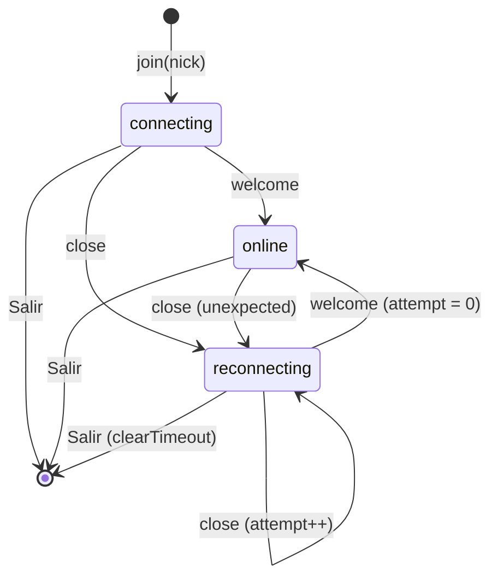

# Design: Frontend hardening

## Technical Approach

Three independent pieces that share one edit of `index.html`:

- **Split + CSP (server side)**: the inline `<style>` and `<script>` of
  `cmd/chatroom/index.html` move **verbatim** (then edited) to `cmd/chatroom/app.css` and
  `cmd/chatroom/app.js`, embedded next to `index.html` with the existing
  `//go:embed` + `[]byte` pattern. `newRouter` gains two explicit routes. One helper writes
  the common headers (`nosniff`, `Cache-Control: no-cache`) for all three responses; `GET /`
  additionally sends a fixed CSP (built once at startup from a Go slice of image hosts) and
  keeps `X-Frame-Options: DENY`. The two `style=""` attributes become classes.
- **Image allowlist (page)**: `IMAGE_URL.test(text)` is replaced by `isAllowedImage(text)`
  (`new URL()`, `https:`, exact host in `IMAGE_HOSTS`, image extension). `IMAGE_HOSTS`
  mirrors the Go slice; a Go test fails if they drift. CSP `img-src` is the browser-enforced
  backstop.
- **Reconnect (page)**: `connect()` is extracted from `join()`. An unexpected `close`
  schedules `connect()` with exponential backoff + jitter; `welcome` (not `open`) marks the
  page `online` and resets the backoff. "Salir" cancels the timer and drops the socket.

No server behavior changes beyond the two routes and the headers; `internal/chat` is not
touched. The page still works at any host/port (`location.host` is already used).

## Architecture Decisions

### Decision: Flat files in `cmd/chatroom/`, one `[]byte` per asset, two explicit routes

**Choice**:

    //go:embed index.html
    var indexHTML []byte
    //go:embed app.js
    var appJS []byte
    //go:embed app.css
    var appCSS []byte

    r.GET("/", servePage)
    r.GET("/app.js", serveAsset("text/javascript; charset=utf-8", appJS))
    r.GET("/app.css", serveAsset("text/css; charset=utf-8", appCSS))

with

    // setStaticHeaders applies the headers every embedded response shares.
    func setStaticHeaders(c *gin.Context) {
        c.Header("X-Content-Type-Options", "nosniff")
        c.Header("Cache-Control", "no-cache")
    }

`serveAsset` returns a `gin.HandlerFunc` that calls `setStaticHeaders` then
`c.Data(200, contentType, body)`. `servePage` calls `setStaticHeaders`, sets
`Content-Security-Policy` and `X-Frame-Options: DENY`, then serves `indexHTML` as
`text/html; charset=utf-8`.
**Alternatives considered**: `cmd/chatroom/static/` + `embed.FS` + `r.StaticFS` (directory
handling, zero mod-times, `http.FileServer` content-type sniffing by extension table, and a
third file today does not justify it); `embed.FS` with hand-written routes (same two routes,
plus an FS read and error path per request); `Cache-Control: max-age` + content-hashed URLs
(needs a build step or a hash-in-URL rewrite of `index.html` — overkill for ~25 KB).
**Rationale**: matches the existing `indexHTML` pattern exactly; the route list is the asset
list (no accidental exposure of other files). `no-cache` = "revalidate every time"; without
an ETag the browser just refetches, so a redeployed binary is never served stale JS against
a new page (proposal risk "old cached index.html"). An ETag is YAGNI at this size.

### Decision: Exact CSP for `GET /`

**Choice** (one line, computed once into a package-level `var contentSecurityPolicy =
buildCSP(imageHosts)`):

    default-src 'none'; script-src 'self'; style-src 'self' https://fonts.googleapis.com;
    font-src https://fonts.gstatic.com; img-src 'self' https://media.giphy.com
    https://media0.giphy.com https://media1.giphy.com https://media2.giphy.com
    https://media3.giphy.com https://media4.giphy.com https://i.giphy.com
    https://media.tenor.com https://i.imgur.com; connect-src 'self'; base-uri 'none';
    form-action 'none'; frame-ancestors 'none'

`buildCSP(hosts []string) string` joins the directives with `"; "` and renders `img-src` as
`'self'` + `"https://" + host` for each host. Only on `GET /` (JS/CSS responses are not
documents). `X-Frame-Options: DENY` is kept for browsers without `frame-ancestors`.

What the page needs, checked against `index.html`:

| Need | Directive | Note |
|---|---|---|
| `/app.js` | `script-src 'self'` | no `'unsafe-inline'`, no `'unsafe-eval'` (no `eval`/`new Function`) |
| `/app.css`, Google Fonts CSS | `style-src 'self' https://fonts.googleapis.com` | the `<link rel="preconnect">` is not a fetch governed by CSP |
| Inter font files | `font-src https://fonts.gstatic.com` | |
| `fill="var(--color-accent)"` on the header SVG | — | SVG presentation attributes are not inline styles; `style-src` only governs `<style>` elements and `style=""` attributes. Left as is. |
| JS-assigned handlers (`img.onload = …`, `addEventListener`) | — | only inline handler **attributes** in markup are blocked; there are none |
| `ws://` / `wss://` same host:port | `connect-src 'self'` | CSP3: `'self'` matches same-origin `ws:`/`wss:`. Current Chrome/Firefox/Safari do this; very old Safari (pre-CSP3 behavior) would block the socket — accepted, friends-only |
| GIFs | `img-src` allowlist | `'self'` only so a same-origin `/favicon.ico` probe does not log a violation (Firefox applies `img-src` to it); same origin cannot leak IPs |
| Join/send forms | `form-action 'none'` | both submit handlers call `preventDefault()`, so no navigation happens. If JS failed to load, a native submit is blocked — desirable (no nickname in a URL) |

**Alternatives considered**: hashes/nonces for inline code (rejected by the proposal);
`connect-src 'self' ws://<Host> wss://<Host>` built from the request `Host` header (reflects
client input into a security header for the benefit of obsolete browsers); `img-src https:`
(defeats the IP-leak backstop); dropping `X-Frame-Options` (costs nothing to keep, SRV-05
already requires it).
**Rationale**: everything is `'self'` or a fixed third-party host, so the policy never
changes when the code changes; the only moving part is the image list, rendered from the same
slice the JS mirrors.

### Decision: Image allowlist — Go slice is the source, JS mirrors it, a test enforces it

**Choice** (Go, `cmd/chatroom/main.go`):

    // imageHosts may be shown inline in the chat (CSP img-src).
    // Mirrored by IMAGE_HOSTS in app.js; TestImageHostsMirroredInJS keeps them in sync.
    var imageHosts = []string{
        "media.giphy.com", "media0.giphy.com", "media1.giphy.com", "media2.giphy.com",
        "media3.giphy.com", "media4.giphy.com", "i.giphy.com",
        "media.tenor.com", "i.imgur.com",
    }

JS (`app.js`), replacing `IMAGE_URL`:

    // Mirrors imageHosts in cmd/chatroom/main.go (CSP img-src). Keep both in sync.
    const IMAGE_HOSTS = new Set([
      'media.giphy.com', 'media0.giphy.com', 'media1.giphy.com', 'media2.giphy.com',
      'media3.giphy.com', 'media4.giphy.com', 'i.giphy.com',
      'media.tenor.com', 'i.imgur.com',
    ]);
    const IMAGE_PATH = /\.(gif|webp|png|jpe?g)$/i;

    // True only when the whole message is one https image URL on an allowlisted host.
    function isAllowedImage(text) {
      if (/\s/.test(text)) return false;
      let url;
      try { url = new URL(text); } catch { return false; }
      return url.protocol === 'https:' && IMAGE_HOSTS.has(url.hostname) &&
        url.port === '' && url.username === '' && url.password === '' &&
        url.hash === '' && IMAGE_PATH.test(url.pathname);
    }

Used in `addChat` (render decision) and in the GIF panel (`gif-send` enable check and click
guard). `img.src = text`, `referrerPolicy = 'no-referrer'`, `loading = 'lazy'` and the
`onerror` text fallback stay. The GIF panel hint and placeholder name the supported hosts
(e.g. "Pegá la URL de un GIF de Giphy, Tenor o Imgur.").
Semantics vs. today's `IMAGE_URL`: query string still allowed (extension checked on the
path, as before); whitespace, fragment, credentials, explicit port, trailing-dot host
(`media.giphy.com.`) and look-alikes (`media.giphy.com.evil.example`,
`evil.example/media.giphy.com/x.gif`) are rejected and render as text. `new URL` lowercases
the host, so `MEDIA.GIPHY.COM` is accepted; the path extension is case-insensitive as today.
**Alternatives considered**: serving the list to the page (inline JSON needs a nonce/hash;
a `/config.js` endpoint is a third route for nine strings); regex on the whole string (the
proposal requires `new URL`; host regexes are where bypasses live); comment-only sync like
`MAX_MESSAGE_BYTES` (the drift here is security-relevant — a host in JS but not in CSP gives
broken images, a host in CSP but not in JS is harmless — so a 20-line test is worth it).
**Rationale**: one Go slice drives the header; the test makes the mirror mechanical. Port is
rejected because a CSP host-source without a port only matches 443, so such a URL would
render as a broken image anyway.

### Decision: Reconnect state machine — online on `welcome`, backoff reset on `welcome`

**Choice**: page-level state (inside the existing IIFE):

    const RETRY_BASE_MS = 1000, RETRY_MAX_MS = 30000;
    let requestedNick = '';   // what the user typed; re-sent on every reconnect
    let retryTimer = null;    // pending setTimeout id, or null
    let attempt = 0;          // consecutive failed attempts since the last welcome
    let outage = false;       // a "connection lost" notice is on screen

| State (`data-state`) | Label | Entered when |
|---|---|---|
| `connecting` | `Conectando…` | `join()` (first attempt of a session) |
| `online` | `En línea` | `welcome` received |
| `reconnecting` | `Reconectando…` | unexpected `close` (timer pending, or retry socket opening) |

- `join(nick)`: as today (clear list, swap views, focus) plus `requestedNick = nick`,
  `attempt = 0`, `outage = false`, `setStatus('connecting')`, `connect()`.
- `connect()`: `retryTimer = null`; open `new WebSocket(scheme + location.host +
  '/ws?nickname=' + encodeURIComponent(requestedNick))`; `ws = socket`; `onmessage` and
  `onclose` keep the `if (ws !== socket) return` guard. No `onopen` handler.
- `onclose` → `scheduleReconnect()`: `ws = null`; `setStatus('reconnecting')`; if
  `!outage` → `outage = true`, `addSystem('Conexión perdida, reconectando…')`;
  `d = min(RETRY_MAX_MS, RETRY_BASE_MS * 2 ** attempt)`; `attempt++`;
  `retryTimer = setTimeout(connect, d / 2 + Math.random() * d / 2)` (equal jitter:
  0.5–1 s, 1–2 s, 2–4 s … 15–30 s).
- `welcome` (existing case, extended): set `myName` / `#me` as today, then `attempt = 0`,
  `setStatus('online')`, and if `outage` → `outage = false`, `addSystem('Reconectado')`.
- "Salir": `clearTimeout(retryTimer); retryTimer = null;` then the existing
  `if (ws) { const s = ws; ws = null; s.close(); }`. With `ws === null` the old socket's
  `close` is ignored and no timer exists, so nothing can reconnect. Re-joining calls `join()`
  which resets all of the above.
- `reconnectNow()`: `if (retryTimer === null) return; clearTimeout(retryTimer); connect();`
  — called on `window` `online` and on `document` `visibilitychange` when `!document.hidden`.
  It only short-circuits a pending wait; it never opens a second socket and does not reset
  `attempt`.
- The message list is kept across reconnects (only `join()` clears it). Messages sent by
  others during the outage are lost (out of scope → `chat-features`).
- No close-code special cases: every unexpected close retries, forever, capped at 30 s.

**Alternatives considered**:
- *Reset backoff / go online on `open`*: during server shutdown the upgrade can succeed and
  the room closes the socket immediately (CHAT-08 "Connect during shutdown"), giving a tight
  1 s loop with flicker. `welcome` proves the client is registered.
- *Stop on close code 1008 (origin rejected)*: this server rejects origins with HTTP 403
  before the upgrade, which the browser reports as `1006`, indistinguishable from "server
  down"; the server never sends 1008. Server shutdown and slow-client drops both send `1000`,
  and both should retry. So codes carry no usable signal here.
- *Give up after N attempts → `offline`*: forces a manual action after a long outage
  (e.g. laptop asleep overnight) for no gain; a 30 s retry costs nothing at this scale. The
  `offline` state and its CSS rule are removed since nothing reaches them.
- *Pause while `navigator.onLine === false`*: `onLine` is unreliable (false positives on
  some Linux/VPN setups would stall forever); the `online` event is only used to retry
  sooner.
- *Request `myName` (e.g. `bob (2)`) instead of the typed nick*: if the server still holds
  the dead connection, `bob (2)` becomes `bob (2) (2)`; the typed nick gives at worst
  `bob (2)` until the old conn's pong timeout (accepted in the proposal).

**Rationale**: smallest change that satisfies the proposal; `welcome` is already the page's
identity source (CHAT-14), so making it the "connected" signal adds no new concept.
`visibilitychange` matters because hidden-tab timers can be throttled to once a minute; on
wake the tab reconnects immediately.

### Decision: Status pill and inline-style removal

**Choice**: in `app.css`, replace the `offline` rule with

    .status[data-state="reconnecting"] { --dot: var(--color-accent-600); }
    .status[data-state="reconnecting"] .dot { animation: pulse 1.2s ease-in-out infinite; }
    @keyframes pulse { 50% { opacity: 0.35; } }
    @media (prefers-reduced-motion: reduce) { .status .dot { animation: none; } }

`STATUS_LABEL = { connecting: 'Conectando…', online: 'En línea', reconnecting: 'Reconectando…' }`.
The two attributes become classes: `<div class="text-muted subtitle">Sala general</div>` with
`.chat-header .subtitle { font-size: 12px; }`, and `<div class="gif-hint">` with
`.gif-hint { font-size: 13px; line-height: 1.45; }`.
**Alternatives considered**: a new warning color token (Nocturne has none; inventing one is
out of scope); color-only change (accent vs accent-600 is too subtle to notice).
**Rationale**: the pulse distinguishes "trying" from "connected" without new tokens; CSS
animations are unaffected by CSP.

## Data Flow

    browser ──GET /──────→ servePage: nosniff, no-cache, CSP, XFO → index.html
            ──GET /app.css→ serveAsset(text/css)        ─┐ nosniff, no-cache
            ──GET /app.js─→ serveAsset(text/javascript) ─┘
            ──fonts.googleapis.com / fonts.gstatic.com (style-src / font-src)
            ──GET /ws?nickname=<typed>──→ HandleWebSocket (unchanged)
    chat frame text ──isAllowedImage?──yes→  (CSP img-src backstop)
                                    └─no──→ textContent

    imageHosts (main.go) ──buildCSP──→ Content-Security-Policy img-src
          └── mirrored by IMAGE_HOSTS (app.js) ── checked by TestImageHostsMirroredInJS

### Page connection states



### Drop → backoff → reconnect → welcome

```mermaid
sequenceDiagram
    participant U as User
    participant P as Page (app.js)
    participant T as setTimeout
    participant S as Server /ws
    S--xP: close (restart / Wi-Fi drop)
    P->>P: ws === socket? yes → scheduleReconnect()
    P->>P: ws = null; status reconnecting; notice "Conexión perdida, reconectando…" (once)
    P->>T: retryTimer = setTimeout(connect, 0.5–1 s); attempt = 1
    T->>P: connect()
    P->>S: GET /ws?nickname=bob
    S--xP: refused / 1006 (server still down)
    P->>T: retryTimer = setTimeout(connect, 1–2 s); attempt = 2 (no new notice)
    Note over P: window "online" or tab visible → reconnectNow(): clearTimeout + connect()
    T->>P: connect()
    P->>S: GET /ws?nickname=bob
    S->>P: {"type":"welcome","from":"bob",...}
    P->>P: myName = "bob"; attempt = 0; status online; notice "Reconectado"
    S->>P: {"type":"join","from":"bob",...}
    U->>P: clicks "Salir" (any time)
    P->>T: clearTimeout(retryTimer)
    P->>S: ws = null; s.close() → its close event is ignored
```

## File Changes

| File | Action | Description |
|------|--------|-------------|
| `cmd/chatroom/app.js` | Create | The former inline script (same IIFE) + `IMAGE_HOSTS` / `isAllowedImage` replacing `IMAGE_URL`; `connect` / `scheduleReconnect` / `reconnectNow`; `welcome` sets online and resets backoff; leave clears the timer; `STATUS_LABEL` with `reconnecting`, without `offline` |
| `cmd/chatroom/app.css` | Create | The former inline style + `.subtitle`, `.gif-hint`, `reconnecting` pill rule and pulse; `offline` rule removed |
| `cmd/chatroom/index.html` | Modify | `<style>` → `<link rel="stylesheet" href="/app.css">` (after the Google Fonts link); `<script>…</script>` → `<script src="/app.js"></script>` at the same place (end of body); two `style=""` → classes; GIF hint text and placeholder mention the allowed hosts |
| `cmd/chatroom/main.go` | Modify | `appJS` / `appCSS` embeds, `imageHosts`, `buildCSP`, `contentSecurityPolicy`, `setStaticHeaders`, `servePage`, `serveAsset`, two routes |
| `cmd/chatroom/main_test.go` | Modify | Tests below |
| `README.md` | Modify | Drop the "use `localhost`, not `127.0.0.1`" note; document the image allowlist (where to extend: `imageHosts` + `IMAGE_HOSTS`), CSP, and reconnect behavior |

`internal/chat` is unchanged. Specs are written in parallel: **SRV-02** (also serves
`/app.js` and `/app.css` with exact content types, `nosniff`, `no-cache`), **SRV-05** (CSP on
`GET /` with the exact policy, no `'unsafe-inline'`; `X-Frame-Options` kept), **CHAT-15**
"Inline images only from allowlisted hosts", **CHAT-16** "Page reconnects automatically".
CHAT-14 is unchanged in text; note for the spec writer that the page now considers itself
online on `welcome` (CHAT-16 should state it).

## Interfaces / Contracts

```go
var imageHosts []string                 // source of truth for img-src and IMAGE_HOSTS
var contentSecurityPolicy = buildCSP(imageHosts)

func buildCSP(hosts []string) string
func setStaticHeaders(c *gin.Context)  // nosniff + Cache-Control: no-cache
func servePage(c *gin.Context)         // static headers + CSP + X-Frame-Options, index.html
func serveAsset(contentType string, body []byte) gin.HandlerFunc
```

| Route | Content-Type | Extra headers |
|---|---|---|
| `GET /` | `text/html; charset=utf-8` | `nosniff`, `no-cache`, CSP, `X-Frame-Options: DENY` |
| `GET /app.js` | `text/javascript; charset=utf-8` | `nosniff`, `no-cache` |
| `GET /app.css` | `text/css; charset=utf-8` | `nosniff`, `no-cache` |

## Testing Strategy

Go (`cmd/chatroom/main_test.go`, `go test -race ./...`, existing `newTestServer`):

| Test | Asserts |
|---|---|
| `TestStaticAssets` (table: `/`, `/app.js`, `/app.css`) | 200; exact `Content-Type`; `X-Content-Type-Options: nosniff`; `Cache-Control: no-cache`; body equals the embedded var |
| `TestIndexSecurityHeaders` (extended) | existing XFO/nosniff + `Content-Security-Policy` equals the **literal** policy string written in the test (deliberate: changing the policy or the allowlist must touch the test); does not contain `unsafe-inline` / `unsafe-eval` |
| `TestIndexHasNoInlineCode` | on `indexHTML`: no `<style`, no `style=`; every `<script` tag has `src=` (regexp `(?i)<script\b[^>]*>` matches all contain `src=`); no inline handler attributes (`(?i)\son[a-z]+\s*=`). Cheap guard against reintroducing what CSP would block |
| `TestImageHostsMirroredInJS` | extract `const IMAGE_HOSTS = new Set([ … ])` from `appJS` with `(?s)const IMAGE_HOSTS = new Set\(\[(.*?)\]\)`, collect `'([^']+)'`; sorted list equals sorted `imageHosts` (fails on drift in either direction) |
| `TestIndexReferencesAssets` (optional, can merge into the inline test) | `indexHTML` contains `src="/app.js"` and `href="/app.css"` |

Manual browser checklist (Chrome + Firefox, DevTools console and network open, no JS test
infrastructure exists):

| # | Step | Expected | Proposal criterion |
|---|---|---|---|
| M1 | Open `http://127.0.0.1:8080/`, join, chat in two tabs | page styled (Inter loaded), chat works, **zero CSP violations** in console | CSP; `127.0.0.1` |
| M2 | Same at `http://localhost:8080/` and the LAN IP | same | CSP `connect-src 'self'` |
| M3 | Send `https://media.giphy.com/media/<id>/giphy.gif` (and via GIF panel) | renders inline | allowlist |
| M4 | Send `https://evil.example/x.gif`, `https://media.giphy.com.evil.example/x.gif`, `https://media.giphy.com:8443/x.gif` | text; no request to those hosts in Network; GIF panel "Enviar" disabled for them | allowlist |
| M5 | In console: `document.body.append(Object.assign(new Image(), {src:'https://evil.example/x.gif'}))` | blocked by CSP `img-src` (violation logged — expected here) | backstop |
| M6 | Stop the server; wait 10 s; start it | pill pulses `Reconectando…`, one "Conexión perdida…" notice, then `En línea` + "Reconectado"; can chat again without reload | reconnect |
| M7 | While reconnecting (server down), click "Salir"; start server; wait 40 s | stays on join view; Network shows no new `/ws` attempts | Salir |
| M8 | Online, click "Salir" | no notice, no reconnect | Salir |
| M9 | Server down 2+ min | retry gaps grow to ≤ 30 s (Network timeline); then DevTools "Offline" → "No throttling" triggers an immediate attempt | backoff, `online` event |
| M10 | Kill Wi-Fi briefly with the server up (or DevTools offline ≥ pong timeout) | reconnects; name may be `bob (2)` until the old connection times out (accepted) | reconnect |
| M11 | Reload after redeploying a changed `app.js` | new JS loaded (`no-cache`) | stale assets |

Plus `go vet ./...` and `go test -race ./...`.

## Migration / Rollout

No persisted data, no wire change. Deploy = replace binary; open tabs from the old version
keep working (same `/ws` protocol) until reloaded, then get the new page.

## Rollback

Revert the change's commits and redeploy. If only the CSP misbehaves in production, remove
the `Content-Security-Policy` header line in `servePage` (and its test assertion) on its
own: the split files, allowlist and reconnect keep working without it (the JS allowlist
still prevents rendering foreign images).

## Open Questions

- [x] CHAT-16 states "online after `welcome`" and that `offline` is no longer a page state
      (resolved in the specs phase; `gif-picker` backlog group already added with the proposal).
